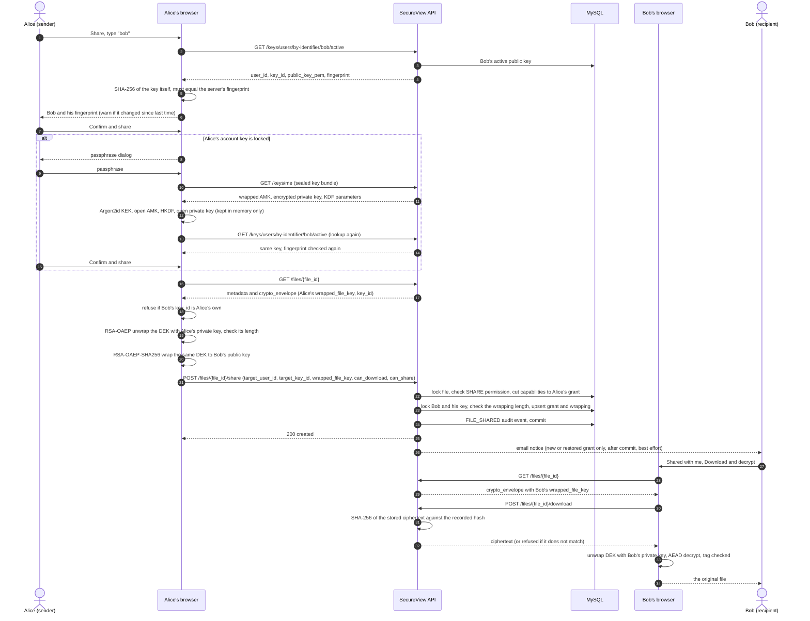

# Security Flows

English | [简体中文](SECURITY_FLOWS.zh-CN.md)

These flows describe the implemented transaction and trust boundaries. Authentication,
client-wrapped account keys, encrypted-file storage, sharing, audit queries, recovery, and
administration are active application routes.

The design provides **client-side key custody**, not metadata anonymity and not protection
against a malicious client. The API never needs a user's passphrase, account master key
(AMK), plaintext RSA private key, plaintext file data-encryption key (DEK), or plaintext file
contents. It does store and return ciphertext and the public metadata needed to interpret it.

## Shared Preconditions

Protected requests accept an opaque access token through
`Authorization: Bearer <token>`. The API hashes it with SHA-256, resolves an active and
unexpired server-side session and ACTIVE user, and supplies a trusted `ActorContext`.
Unknown, disabled, expired, revoked, and malformed credentials receive the same public
authentication response.

Secret-bearing responses use `Cache-Control: no-store, no-cache` and `Pragma: no-cache`.
Passwords, passphrases, tokens, plaintext private keys, AMKs, plaintext DEKs, request bodies,
and authorization headers must be excluded from application, proxy, and tracing logs.
Ciphertext, wrapped keys, public keys, salts, nonces, and authentication tags are not
plaintext secrets, but logging them still creates unnecessary replay, correlation, and
offline-attack material and should be avoided.

## Two Independent Secrets

The login password and encryption passphrase are separate:

- The login password authenticates to the server. The server stores an Argon2id password
  hash and can change this password after verifying the current password.
- The encryption passphrase is processed only by the client. Argon2id derives a key-
  encryption key (KEK), which decrypts the stored wrapped AMK. An AMK-derived key decrypts
  the client-encrypted PKCS#8 private-key bundle.

Changing the login password does not re-encrypt the private-key bundle. Changing the
encryption passphrase requires the client to unlock the existing AMK, wrap the same AMK
under a new Argon2id-derived KEK, and unlock the newest current private key. The client sends
the complete proposed KDF/AEAD envelope, current key UUID, and expected profile revision to
`POST /keys/me/rewrap/signing-payload`, signs the returned 32-byte digest locally with
RSA-PSS-SHA256, then sends the exact proposal plus signature to `POST /keys/me/rewrap`.

Argon2id only raises the cost of offline guessing. A database compromise exposes the salt,
Argon2 parameters, wrapped AMK, encrypted private-key bundle, and their non-secret metadata,
so a weak passphrase remains vulnerable to offline guessing.

## Emailed Verification Codes

Registration and login-password reset both require a one-time code delivered to the address
being claimed. `POST /auth/verification-codes/send` issues one for a `REGISTRATION` or
`PASSWORD_RESET` purpose.

The code itself is never stored. The row keeps an HMAC-SHA-256 digest keyed by the server
secret, the purpose, and the normalized address, so reading the database does not reveal a
pending challenge and a digest cannot be replayed against a different purpose or address.
Codes expire (10 minutes by default), are single use, and are invalidated once the per-code
attempt limit is reached. Issuing a new code invalidates the address's other pending codes
for the same purpose.

The send endpoint returns an identical response whether or not the address has an account,
and consumes its rate-limit allowance either way, so it cannot be used to enumerate
registered users. A code is emailed only when the address is genuinely eligible: an
unregistered address for `PASSWORD_RESET`, or an already-registered address for
`REGISTRATION`, silently produces no mail and no row. Sending and checking are separately
throttled per address and per IP through the shared `auth_login_throttles` table, and a
resend inside the cooldown is refused with `Retry-After`.

A rejected attempt commits its own attempt counter and throttle updates before the caller's
transaction rolls back. Without that, the rollback that discards the failed registration or
reset would also discard the evidence of the guess, leaving a live code open to unlimited
guessing.

Delivery goes through a configured provider (`resend` over HTTPS, generic `smtp`, or a
development-only `console` sink that logs instead of sending and is rejected outside
development/test). Email is an unauthenticated channel: possession of the mailbox is the only
factor these codes prove.

## Login-Password Reset

`POST /auth/password-reset` takes the username, address, code, and new password. The code is
consumed before the username/address pair is judged, so a mismatched pair spends an attempt
rather than revealing that the code was valid; every failure returns the same generic
response. Success writes a new Argon2id hash, records `password_changed_at`, and revokes
every session family.

Reset deliberately touches nothing cryptographic. The key-protection profile and encrypted
private-key bundle are untouched, because the encryption passphrase is a separate secret the
server never holds. This is why the reset is safe to offer over email at all: an attacker who
takes over the mailbox gains the account's server-side session, but not the AMK, the private
key, or any file plaintext.

The same property sets the limit of this recovery channel. A forgotten **encryption
passphrase** cannot be reset by email or by any other server-side action, because the server
holds no material that can open the AMK envelope. It can be reset only by someone holding the
private key file issued at registration — see
[Passphrase reset with the private key file](#passphrase-reset-with-the-private-key-file).

## Registration and Account-Key Custody

Registration additionally consumes a `REGISTRATION` code for the submitted address, and the
stored account is therefore created with `email_verified` already true.

Before registration, the trusted client:

```text
generate RSA key pair locally at configured size
  (3072 bits by default; supported configuration values are 2048/3072/4096)
  -> generate a random 256-bit AMK
  -> derive a 256-bit KEK from passphrase using Argon2id and a random salt
  -> AES-256-GCM wrap the AMK with the KEK and versioned AAD
  -> derive a private-key encryption key from the AMK with HKDF-SHA256
  -> AES-256-GCM encrypt the PKCS8-DER private key with fresh salt/nonce and versioned AAD
  -> self-test unlock, public/private key correspondence, and envelope round trip
  -> send public key plus encrypted envelopes as key_material in /auth/register
```

The server normalizes and validates the account fields, applies registration throttling,
hashes the login password with Argon2id, validates the submitted RSA public key and its
declared size, computes its SHA-256 fingerprint, verifies envelope shapes and ciphertext
hashes, then atomically stores:

- the USER account and public identifiers;
- the public RSA key and fingerprint;
- the Argon2id/KEK-wrapped AMK protection profile;
- the AMK-derived AES-GCM encrypted private-key bundle; and
- the `AUTH_REGISTERED` audit event.

The response contains the user, key UUID, and public-key fingerprint. It never contains a
private key. The server can validate the public key and envelope structure but, by design,
cannot decrypt the bundle or prove that its ciphertext contains the matching private key;
the client self-test is therefore required before committing registration.

An authenticated client retrieves its stored encrypted material with `GET /keys/me`. Other
authenticated users can retrieve only an active public encryption key with
`GET /keys/users/{user_id}/active`.

To add a successor key without trusting only the bearer session, the client prepares the new
public key and encrypted private-key bundle, binds them to the current key UUID, protection-
profile UUID and expected revision, obtains the server-defined canonical signing digest, and
signs it locally with the newest current private key using RSA-PSS-SHA256. The server verifies
that signature before storing the successor. Previous keys and file wrappings remain stored;
`GET /keys/me/{key_id}` lets the owner retrieve a historical encrypted bundle when decrypting
a file still wrapped to that key. The configured account key size is 3072 bits by default and
must match registration and successor inputs.

Passphrase rewrap has the same possession boundary. Its canonical digest is domain-separated
from key addition and binds the actor UUID, newest current key UUID, profile UUID/revision,
all Argon2id parameters, and every field of the proposed wrapped-AMK AES-GCM envelope. The
server locks and rechecks both revision and newest key, verifies the RSA-PSS-SHA256 signature,
and only then replaces the protection profile and appends the audit event in one transaction.
This prevents a stolen bearer session alone from replacing the wrapped AMK with an attacker-
controlled envelope. A modified field no longer matches the signed digest. Neither rewrap
call receives a passphrase, AMK, KEK, or plaintext private key.

### Passphrase-loss semantics

The user normally needs to remember only the encryption passphrase; the encrypted bundle
can be fetched again after login. A forgotten passphrase loses the AMK, which the server cannot
reset or reveal. The separately held factor is the private key file shown once at registration:
with it the user sets a new passphrase (see
[Passphrase reset with the private key file](#passphrase-reset-with-the-private-key-file)) and
keeps every file. Without it as well, the existing private key is cryptographically
unrecoverable. The implemented file-recovery
workflow does **not** recover a passphrase or decrypt a private-key bundle; it only rewraps a
file DEK to an already registered active user public key. Consequently, recovery is useful
only when the requester can use the target key's private half.

The current schema has one account-level AMK protection profile with revision history, not a
versioned series of AMKs. Successor private-key bundles must therefore remain encrypted under
keys derived from that existing AMK. Adding a successor RSA key is not an AMK reset and does
not make a forgotten passphrase recoverable.

### Passphrase reset with the private key file

A forgotten passphrase loses the AMK, and nothing — not the server, not the recovery officer,
not the offline recovery key — can recover it. What survives is the plaintext PKCS#8 private
key the browser shows once at registration. That file is the thing the AMK exists to protect:
it alone unwraps every file key addressed to the account. A holder of it can already decrypt
everything, so allowing that holder to seal it again under a new passphrase grants no
capability they did not have.

The reset therefore creates a **new AMK**, wraps it under a KEK from the new passphrase, and
re-encrypts the same private key under an HKDF key derived from the new AMK. Both envelopes
are replaced in place, keeping their profile and bundle ids so AAD-1 and AAD-2 are rebuilt
unchanged. The key pair and its id are untouched, so every file wrapping, share grant, and
recovery wrapping stays valid and no file is re-encrypted.

- **Proof of possession.** `POST /keys/me/reset-protection` accepts the new envelopes only with
  an RSA-PSS-SHA256 signature by the account private key over a digest binding the actor, key,
  both expected revisions, and every field of both envelopes, under its own domain label. The
  server cannot check that the envelopes open, so without this a stolen session alone could
  overwrite them with garbage and lock the owner out. Rewrap and addition signatures cannot be
  replayed as a reset.
- **Nothing sensitive reaches the server.** The file is read in the browser; only ciphertext
  envelopes and the signature are sent. The browser proves the file belongs to this account
  (an OAEP round trip against the registered public key), reopens the new envelopes locally
  before sending, and re-fetches and reopens them afterwards.
- **Single-key accounts only.** One AMK seals every bundle. With one private key in hand, a
  reset would leave any other bundle — and every file wrapped to it — permanently unopenable,
  so an account holding more than one key is refused with
  `key_protection_reset_unavailable`. Accounts gain a second key only through
  `POST /keys/add`, which the browser does not yet call.
- **Interruption is safe.** Both rows change in one transaction. A failure before commit changes
  nothing; a failure after it leaves the new passphrase working. Either way the key file still
  opens every file, because the key pair never changes.
- **Not a remedy for a leaked passphrase.** The new AMK protects the rows from now on, but a
  database dump taken earlier still holds the old envelopes, which the old passphrase opens.
  The private key itself is unchanged; a suspected key compromise needs successor-key rotation,
  not a passphrase reset.

### Passphrase change with the current passphrase

Since [PR #201](https://github.com/jsonrar/fyp-secure-file-platform/pull/201) Settings also changes the passphrase while the current one is known. The
current passphrase opens the stored envelopes in the browser, which yields the same private key
bytes the key file would; from there the flow is exactly the reset above (new AMK, both envelopes
replaced, RSA-PSS signature by the key, read back and reopened). A wrong current passphrase is
refused before anything is sealed or sent. It shares the reset's limits: single-key accounts only,
and not a remedy for a passphrase that has leaked.

### Passphrase strength checks

The passphrase never reaches the server, so its strength can only be checked in the browser. The
minimum is 10 characters and it must differ from the login password. Since [PR #205](https://github.com/jsonrar/fyp-secure-file-platform/pull/205) (threat
model F-04, R-1) registration, the change above and the key-file reset also refuse passphrases on
a common list, ones made of repeated or sequential characters, and ones that are mostly the
username or email, and suggest four or more random words. A modified client could skip these
checks; they protect users from their own weak choices, not the server from an attacker.

## Login, Refresh, Revocation, and Password Change

Login uses persisted HMAC-keyed account/IP throttle buckets, a per-worker memory-capacity
gate, real-or-dummy Argon2id verification, and generic public failures. Successful login
creates independent high-entropy access and refresh credentials, stores only their hashes,
enforces active-session limits, and appends an audit event in the same transaction.

Refresh credentials are generation-numbered and single-use. Rotation consumes the current
refresh credential and replaces both access and refresh credentials. Replay of a consumed
refresh credential revokes the whole session family. Absolute expiry prevents indefinite
rotation.

Logout revokes the current family; logout-all revokes every active family for the account.
Password change rechecks the current password under lock, applies the full password policy,
writes a new Argon2id hash, and revokes every session. None of these operations changes the
client-side encryption passphrase or key envelopes.

Forgotten-login-password reset and email verification are implemented with emailed codes
(see Emailed Verification Codes and Login-Password Reset above). MFA and external identity
federation are not implemented and stay out of scope. All of these are distinct from file-key
recovery.

## Encrypted Upload

The client obtains the active recovery public key, generates a random DEK and nonce for the
suite the user chose (AES-128/192/256-GCM, AES-256-GCM-SIV or ChaCha20-Poly1305 with a 96-bit
nonce; XChaCha20-Poly1305 with a 192-bit nonce; AES-256-GCM by default), encrypts the file
locally, and wraps the DEK twice with
RSA-OAEP-SHA256: once to its own active public key and once to the recovery public key.
AES-GCM runs on the browser's WebCrypto; AES-256-GCM-SIV and both ChaCha suites run in
`@noble/ciphers`. AES-192-GCM is the one suite some browsers lack natively (Chromium never
shipped it), so the client probes WebCrypto once per key length and, where it refuses, performs
AES-GCM in `@noble/ciphers` too. The two produce identical ciphertext and tags, so all six suites
are offered in every browser and a file sealed in one browser opens in any other. AES-256-GCM
never falls back: the account key envelopes depend on it, and a browser without it is refused.
It then sends a multipart request containing the ciphertext and a JSON metadata envelope.

```text
client: encrypt plaintext and prepare owner/recovery DEK wrappings
  -> server: validate versioned envelope, UUIDs, algorithms, key ownership, and RSA sizes
  -> stream ciphertext to a bounded random staging object and compute SHA-256
  -> require ciphertext length == declared plaintext length (GCM tag is separate)
  -> insert file metadata, owner grant, owner wrapping, and recovery wrapping
  -> append FILE_UPLOADED and publish the staged object
  -> commit; compensate only failures known to occur before COMMIT is attempted
```

If the database connection fails after `COMMIT` is sent, its outcome is ambiguous: MySQL may
already have committed. The service therefore preserves the published object in that case and
leaves reconciliation to classify it as referenced or orphaned. Deleting it could corrupt a
successfully committed file record.

An active recovery key and matching recovery wrapping are currently mandatory for upload.
The backend never encrypts plaintext and cannot authenticate the supplied GCM tag because it
does not have the DEK. It validates structure and storage integrity; the client detects a
wrong DEK, nonce, tag, AAD, or ciphertext when local AEAD decryption fails. The server also
enforces the per-account limits (2 GiB stored, 5 GiB per 24 hours) and the
free-disk floor.

## Metadata and Encrypted Download

File access is fail-closed and requires both an ACTIVE logical grant with the requested
capability and a matching ACTIVE user-key wrapping. `GET /files/{file_id}` returns the
authorized user's envelope, including the nonce, tag, their wrapped DEK, and optional
encrypted manifest. `POST /files/{file_id}/download` verifies the stored ciphertext SHA-256
and streams **ciphertext only**. The client combines both responses, unlocks its private key
locally, unwraps the DEK, and performs AEAD decryption and authentication locally. The stored
ciphertext alone can also be saved as `<name>.ciphertext` without unlocking any key.

Every download and the daily integrity sweep recompute the stored-object hash and record the
result. The sweep compares against the digest anchored in the upload's audit event as well as
the `files` row, so rewriting only the database digest does not hide a changed object. An
administrator able to rewrite the object, the row and the whole audit chain could still
replace all three; the external audit checkpoints (see Audit Chain) are what make that
detectable.

Owner deletion is a durable soft delete that revokes grants and wrappings in the same
transaction, then idempotently removes the storage object. A crash between commit and
unlink can leave an object for reconciliation, but it cannot restore logical access.

## Sharing and Revocation

Sharing is a client-side rewrap operation:

```text
sender fetches recipient's active public key
  -> browser computes the key's fingerprint from the key itself, shows the recipient and the
     fingerprint, and warns if it differs from the one remembered for that recipient
  -> sender confirms; the confirmed key is exactly the key used
  -> sender locally unlocks its private key and unwraps the file DEK
  -> sender wraps the same DEK to the recipient with RSA-OAEP-SHA256
  -> POST wrapped_file_key, target_user_id, target_key_id, and capabilities
  -> server requires SHARE permission, attenuates requested capabilities to the sender's grant,
     and validates target/key/wrapping shape
  -> for an existing non-owner grant, require sender can_manage or sender == current granted_by
  -> atomically create/reactivate grant and wrapping plus audit event
```

The server never receives the sender's private key or plaintext DEK. It can verify that the
submitted bytes have the correct RSA ciphertext length, but cannot prove they encrypt the
correct DEK. The client does not decrypt the file before sharing either, because that would
mean downloading all of it first; what it relies on is that RSA-OAEP unwrapping is
authenticated and `unwrapDek` checks the key length, so the DEK it rewraps is the one sealed at
upload, and that a wrong DEK would only make the recipient's download fail its AEAD tag check
(see `docs/crypto/FILE_ENVELOPE.md`, section 6). The target
cannot receive `can_download` or `can_share` when the sender lacks the corresponding capability,
so delegated sharing cannot use another account to regain a denied capability. The canonical
owner grant is immutable, and an unrelated delegated sharer cannot overwrite or revive an
existing non-owner grant.

The fingerprint check addresses T-S5 (a server substituting a recipient's public key). It is
trust-on-first-use per device, and it helps only when people compare the value with the
fingerprint the recipient sees in Settings. Before a recipient saves a shared program or
macro-capable file (`.exe`, `.bat`, `.js`, `.docm`, …) the browser warns them, because the server
cannot scan ciphertext.

Revocation requires REVOKE permission, cannot target the canonical owner, and atomically
revokes the target grant and its active user wrappings. It prevents future server-mediated
access but cannot erase ciphertext, DEKs, or plaintext already copied by a recipient.

### Sharing, end to end

The order below is the order of the calls in `frontend/src/crypto/share.ts`,
`frontend/src/components/ShareDialog.vue` and `backend/app/services/sharing_service.py`. If the
sender's key is still locked, the share stops before anything is fetched, the passphrase dialog
opens, and the dialog comes back to the confirmation step, so the unlock always happens before
the DEK is unwrapped.



The server sees the wrapped DEK for Bob and the ciphertext. It never sees the DEK, either
private key or the plaintext.

## Offline Recovery Boundary

Recovery keys are RSA public keys registered by an ADMIN. Registering a new active key
revokes the previous active key for new uploads; it does not rewrap existing files. The
corresponding old private keys must remain securely available offline for files wrapped to
them.

Recovery requests have a default 24-hour expiry and conditional states. A USER creates and
may cancel a request targeting one of their active public keys only while the file has an
ACTIVE, `can_download` grant and an ACTIVE user wrapping backed by an active user key. This
live-entitlement rule also applies to the canonical owner. An ADMIN or
RECOVERY_OFFICER may approve or reject it, but the requester cannot review their own request.
After approval:

```text
reviewer fetches execution package; server rechecks the requester's live download entitlement
  -> package contains recovery-wrapped DEK, recovery public-key identity,
     and requester's target public key; it contains no private key
  -> isolated offline/HSM process unwraps DEK with recovery private key
  -> offline process immediately wraps DEK to target user public key
  -> reviewer submits only the new RSA ciphertext plus both key UUIDs
  -> server locks and rechecks the live grant and user wrapping, validates identities/lengths,
     creates/updates only the target-key wrapping without changing grant state or capabilities,
     marks request EXECUTED, and appends audit event atomically
```

No endpoint accepts a recovery private key. Operational procedures must keep the offline
private key, decrypted DEK, and rewrap workstation outside normal application logging and
network trust. The current workflow separates requester from reviewer; it does not require
different officers for approval and execution. It also cannot recover a forgotten
encryption passphrase or generate/register a replacement user key. Revocation, removal of
`can_download`, or loss of the active user wrapping blocks subsequent package reads and
execution; recovery never recreates, reactivates, or elevates that grant. An execution package
already delivered and cached before revocation cannot be remotely erased, so offline-package
handling and retention remain part of the recovery trust boundary.

## Metadata Leakage and Threat Limits

The server necessarily learns account identifiers, public keys/fingerprints, KDF parameters,
envelope sizes/versions, plaintext filename, MIME type, declared plaintext size, ciphertext
size, timestamps, ownership and sharing graph, recovery workflow state, IP/user-agent session
metadata, and audit actions. The optional manifest is opaque only when the client encrypts it.
If filename confidentiality is required, a future contract must move the filename and MIME
type into the encrypted manifest and expose only coarse padded values.

The stored Argon2id envelope supports offline passphrase guessing after database theft.
Ciphertext length leaks approximate content length. Traffic analysis and access timing remain
visible. A malicious server can serve rolled-back or substituted ciphertext, key bundles, or
public keys unless clients pin fingerprints/revisions or authenticate a manifest through a
separate trust anchor. The browser now remembers each recipient's fingerprint and warns on a
change, which covers recipient-key substitution after first use, but not rollback of the
user's own bundle or ciphertext. This design therefore provides zero-knowledge **key custody at the API
boundary**, not full anonymity or protection from an actively malicious service.

## Audit Chain

Each security-sensitive mutation appends its event in the same database transaction:

```text
lock singleton audit_chain_heads row FOR UPDATE
canonical_event = deterministic JSON of immutable audit fields
current_hash = SHA-256(previous_hash || canonical_event)
insert audit row and update chain head
```

ADMIN chain verification recomputes the complete chain and checks the head. User audit
queries are scoped and metadata is allowlisted before return. The database-resident hash
chain detects accidental or partial modification, but an administrator who can rewrite the
entire database can recompute it. Staging therefore publishes an HMAC-authenticated
checkpoint of the chain head to external S3-compatible storage on a timer
(`backend/scripts/audit_checkpoint.py`); the HMAC key is root-only and never reaches the
application process, so a later rewrite of the chain no longer matches a published
checkpoint.
