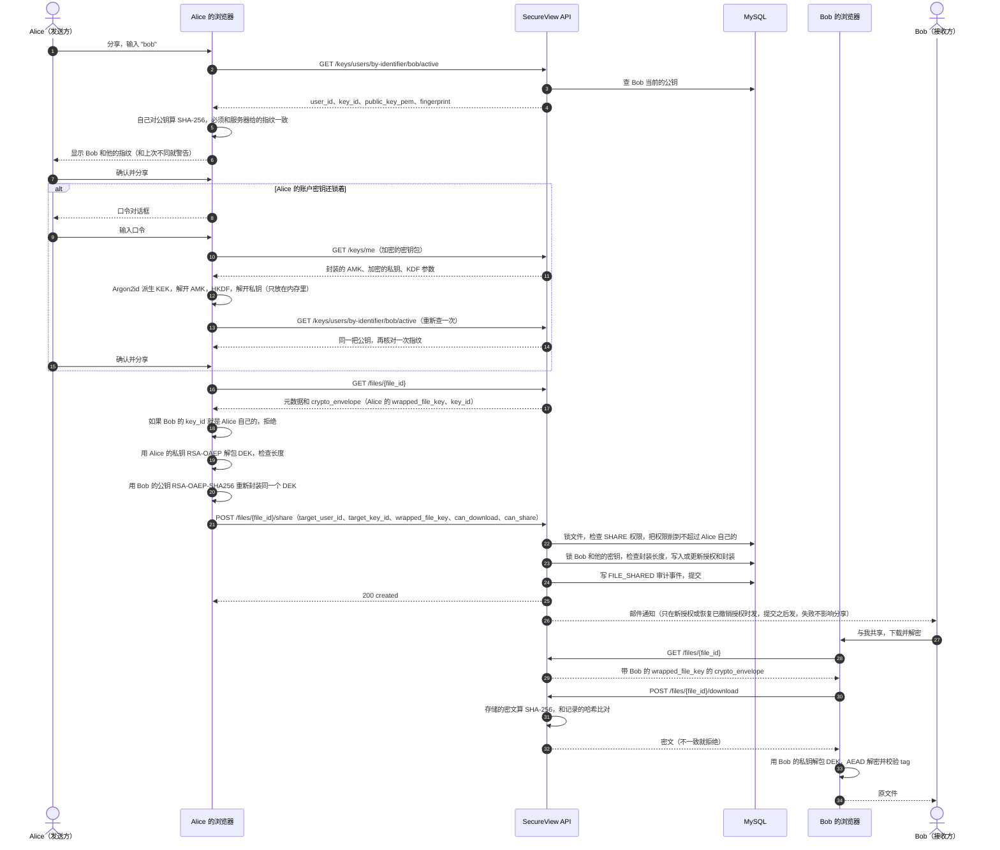

# 安全流程

[English](SECURITY_FLOWS.md) | 简体中文

本文描述当前已经实现的事务边界和信任边界。认证、客户端包装的账户密钥、加密文件存储、
共享、审计查询、恢复及管理接口均为可用路由。

本设计提供的是**客户端密钥托管边界**，而不是元数据匿名，也不能防止恶意客户端。API
不需要取得用户的加密口令（passphrase）、账户主密钥（AMK）、明文 RSA 私钥、明文文件
数据密钥（DEK）或文件明文；但服务器会存储并返回密文及解释密文所需的公开元数据。

## 共同前置条件

受保护请求通过 `Authorization: Bearer <token>` 接收不透明访问令牌。API 对令牌计算
SHA-256，解析出活跃且未过期的服务端会话和 ACTIVE 用户，再创建可信的
`ActorContext`。未知、禁用、过期、撤销及格式错误的凭据得到相同的公开认证响应。

含敏感材料的响应使用 `Cache-Control: no-store, no-cache` 和 `Pragma: no-cache`。
登录密码、加密口令、令牌、明文私钥、AMK、明文 DEK、请求体和授权标头都不得进入应用、
代理或追踪日志。密文、包装密钥、公钥、盐、nonce 和认证标签不是明文秘密，但记录它们仍会
增加重放、关联及离线攻击材料，因此也应避免。

## 两个相互独立的秘密

登录密码与加密口令用途不同：

- 登录密码用于向服务器认证。服务器保存其 Argon2id 哈希；验证当前密码后可以修改它。
- 加密口令只在客户端处理。客户端用 Argon2id 派生密钥加密密钥（KEK），以 KEK 解开已包装
  的 AMK，再用 AMK 派生的密钥解密客户端加密的 PKCS#8 私钥包。

修改登录密码不会重新加密私钥包。修改加密口令时，客户端必须先用旧口令解开现有 AMK，
再用新口令经 Argon2id 派生出的 KEK 重新包装同一个 AMK，并解锁最新当前私钥。客户端把完整
拟议 KDF/AEAD 信封、当前密钥 UUID 和预期 profile revision 发送到
`POST /keys/me/rewrap/signing-payload`，在本地以 RSA-PSS-SHA256 签署返回的 32-byte 摘要，
再把完全相同的拟议配置连同签名发送到 `POST /keys/me/rewrap`。

Argon2id 只能提高离线猜测成本。数据库泄露会暴露盐、Argon2 参数、已包装 AMK、加密私钥包
以及其非秘密元数据，因此弱口令仍可能被离线破解。

## 邮箱验证码

注册与重置登录密码都要求一次性验证码送达所声明的邮箱地址。
`POST /auth/verification-codes/send` 按 `REGISTRATION` 或 `PASSWORD_RESET` 用途签发验证码。

验证码本身从不入库。数据行只保存以服务端 secret、用途及规范化地址为密钥的 HMAC-SHA-256
摘要，因此读取数据库无法还原待用验证码，摘要也无法被挪用到其他用途或地址。验证码会过期
（默认 10 分钟）、只能使用一次，并在达到单码尝试上限后作废。签发新验证码会作废该地址同
用途下的其他待用验证码。

无论地址是否已注册，发送端点都返回完全相同的响应，并同样消耗限流额度，因此无法被用来枚举
已注册用户。只有地址确实符合该用途时才会真正发信：`PASSWORD_RESET` 遇到未注册地址、或
`REGISTRATION` 遇到已注册地址，都会静默地既不发信也不写行。发送与校验通过共享的
`auth_login_throttles` 表按邮箱与 IP 分别限流；冷却期内重发会被拒绝并返回 `Retry-After`。

被拒绝的尝试会在调用方事务回滚之前先独立提交其尝试计数与限流更新。否则，丢弃失败注册或
重置的那次回滚会同时丢弃这次猜测的记录，使一个仍然有效的验证码可被无限次猜测。

投递经由可配置的 provider 完成（HTTPS 的 `resend`、通用 `smtp`，或仅供开发使用、只写日志
不发信且在开发/测试之外被拒绝的 `console`）。邮件是未经认证的通道：这些验证码所能证明的
唯一因素就是对该邮箱的控制权。

## 重置登录密码

`POST /auth/password-reset` 接收用户名、邮箱、验证码与新密码。验证码先于用户名/邮箱一致性
判断被消费，因此不匹配的组合只会消耗一次尝试，而不会泄露验证码是否有效；所有失败都返回同一
个通用响应。成功后写入新的 Argon2id 哈希、记录 `password_changed_at`，并撤销全部 Session
family。

重置刻意不触碰任何密码学状态：密钥保护配置与加密私钥包保持原样，因为加密 passphrase 是服务器
从不持有的另一个密钥。这正是该重置能够通过邮件提供的原因——接管邮箱的攻击者会拿到账户的服务端
会话，但拿不到 AMK、私钥或任何文件明文。

同一性质也划定了此找回通道的边界：遗忘的**加密 passphrase** 无法通过邮件或任何服务端操作重置，
因为服务器不持有任何能打开 AMK 信封的材料。只有持有注册时发放的私钥文件的人才能重置它——参见
[使用私钥文件重置 passphrase](#使用私钥文件重置-passphrase)。

## 注册与账户密钥托管

注册还会消费所提交地址的 `REGISTRATION` 验证码，因此写入的账户 `email_verified` 直接为真。

注册前，可信客户端执行：

```text
按配置长度在本地生成 RSA 密钥对
  （默认 3072 位；支持的配置值为 2048/3072/4096）
  -> 生成随机 256-bit AMK
  -> 使用 Argon2id、随机盐和 passphrase 派生 256-bit KEK
  -> 用 KEK、AES-256-GCM 和带版本 AAD 包装 AMK
  -> 使用 HKDF-SHA256 从 AMK 派生私钥加密密钥
  -> 使用新盐/nonce、AES-256-GCM 和带版本 AAD 加密 PKCS8-DER 私钥
  -> 自测解锁、RSA 公私钥对应关系及信封往返
  -> 将公钥和两个加密信封作为 /auth/register 的 key_material 发送
```

服务器规范化并校验账户字段，执行注册限流，用 Argon2id 哈希登录密码，校验提交的 RSA 公钥
及声明长度，计算 SHA-256 指纹，并检查信封结构和密文哈希。随后在一个事务中写入：

- USER 账户及公开标识符；
- RSA 公钥及指纹；
- 包含 Argon2id 参数和 KEK 包装 AMK 的保护配置；
- 使用 AMK 派生密钥及 AES-GCM 加密的私钥包；
- `AUTH_REGISTERED` 审计事件。

响应仅含用户、密钥 UUID 和公钥指纹，绝不返回私钥。服务器可以检查公钥和信封结构，但按
设计无法解密私钥包，也无法证明密文内确实是对应私钥，因此客户端必须在提交注册前完成自测。

已认证客户端通过 `GET /keys/me` 取回自己的加密材料；其他已认证用户只能通过
`GET /keys/users/{user_id}/active` 取得某用户的活跃加密公钥。

为了避免仅凭 Bearer Session 即可添加后继密钥，客户端准备新公钥及加密私钥包，把它们绑定到
当前密钥 UUID、保护配置 UUID 和预期 revision，取得服务器定义的规范签名摘要，再使用最新
当前私钥在本地以 RSA-PSS-SHA256 签名。服务器验证签名后才保存后继密钥。旧密钥及文件包装
继续保留；当文件仍包装给旧密钥时，所有者可通过 `GET /keys/me/{key_id}` 取回历史加密包。
账户密钥长度默认配置为 3072 位，注册和添加后继密钥都必须与配置匹配。

Passphrase 重包装采用相同的持有证明边界。其规范摘要与新增密钥使用不同 domain，并绑定行为者
UUID、最新当前密钥 UUID、profile UUID/revision、所有 Argon2id 参数及拟议包装 AMK
AES-GCM 信封的每个字段。服务器锁定并重新检查 revision 与最新密钥，验证
RSA-PSS-SHA256 签名后，才在一个事务中替换保护配置并追加审计事件。这可防止攻击者仅凭窃取的
Bearer Session 将包装 AMK 替换成其控制的信封；任何字段被修改后都不再匹配已签摘要。两个
rewrap 调用都不接收 passphrase、AMK、KEK 或明文私钥。

### 加密口令遗失语义

正常情况下，用户只需记住加密口令；登录后可再次从服务器取得加密密钥包。遗忘口令会失去 AMK，
服务器无法重置或透露它。独立保管的那个因子是注册时一次性提供的私钥文件：持有它，用户可以设置
新口令（见下文“使用私钥文件重置 passphrase”）并保留所有文件；连它也丢失时，现有私钥在密码学上
不可恢复。当前文件恢复流程**不会**恢复口令或解密私钥包，只会将文件 DEK 重新包装给一个
已经登记且仍活跃的用户公钥；因此只有请求人能够使用该目标公钥对应的私钥时，恢复才有意义。

当前 Schema 每个账户只有一个带 revision 的 AMK 保护配置，并不存在带版本的一系列 AMK。
后继私钥包因此必须继续由现有 AMK 派生的密钥加密。添加后继 RSA 密钥并不是 AMK 重置，也
不能让遗忘的 passphrase 变得可恢复。

### 使用私钥文件重置 passphrase

遗忘 passphrase 即失去 AMK，而服务器、恢复官员、离线恢复密钥都无法把它找回。能留存下来的，
是浏览器在注册时只展示一次的明文 PKCS#8 私钥。这个文件正是 AMK 存在的意义所在：只有它能解开
发给该账户的每一个文件密钥。持有它的人本来就能解密一切，因此允许其在新 passphrase 下重新封装
它，并没有赋予任何原本不具备的能力。

因此，重置会生成一个**新的 AMK**，用新 passphrase 派生的 KEK 包装它，再用由新 AMK 经 HKDF
派生的密钥重新加密同一把私钥。两个信封原地替换，并保留原有的 profile id 与 bundle id，使
AAD-1 与 AAD-2 的重建结果不变。密钥对及其 id 不受影响，因此每个文件包装、共享授权与恢复包装
都保持有效，无需重新加密任何文件。

- **持有证明。** `POST /keys/me/reset-protection` 只有在附带账户私钥的 RSA-PSS-SHA256 签名时
  才接受新信封；所签摘要以独立的域标签绑定行为者、密钥、两个预期 revision 以及两个信封的全部
  字段。服务器无法检验这些信封能否打开，若没有这一签名，仅凭偷来的会话就能把信封覆盖成垃圾
  数据，把所有者锁在门外。重包装与添加密钥的签名无法被重放为重置。
- **敏感材料不离开浏览器。** 文件在浏览器中读取，只发送密文信封与签名。浏览器会先证明该文件
  属于本账户（针对已登记公钥做一次 OAEP 往返），发送前在本地重新打开新信封，提交后再重新获取
  并打开一次。
- **仅限单密钥账户。** 同一个 AMK 封装着所有私钥包。手上只有一把私钥时，重置会让其他私钥包
  ——以及包装给它们的每个文件——永远无法打开，因此持有多把密钥的账户会以
  `key_protection_reset_unavailable` 被拒绝。账户只有通过 `POST /keys/add` 才会获得第二把
  密钥，而浏览器目前尚未调用该接口。
- **中断是安全的。** 两行在同一事务中变更。提交前失败则什么都不变；提交后失败则新 passphrase
  已经可用。无论哪种情况，密钥文件都仍能打开每个文件，因为密钥对从未改变。
- **不能补救已泄露的 passphrase。** 新 AMK 保护的是此后的数据行，但此前导出的数据库备份仍保存
  着旧信封，旧 passphrase 依然能打开它们。私钥本身并未改变；若怀疑私钥泄露，需要的是后继密钥
  轮换，而不是重置 passphrase。

### 凭当前 passphrase 修改

自 [PR #201](https://github.com/jsonrar/fyp-secure-file-platform/pull/201) 起，记得当前 passphrase 时也可以在设置页修改。当前 passphrase 在浏览器中打开已存的信封，得到与私钥文件
相同的私钥字节；之后的流程与上面的重置完全一样（新的 AMK、替换两个信封、用私钥做 RSA-PSS 签名、读回并重新打开）。当前
passphrase 错误时，任何东西都不会被封装或发送。它与重置有相同的限制：只适用于单密钥账户，也不能补救已经泄露的
passphrase。

### passphrase 强度检查

passphrase 从不到达服务器，所以只能在浏览器里检查强度。最短 10 个字符，且必须不同于登录密码。自 [PR #205](https://github.com/jsonrar/fyp-secure-file-platform/pull/205) 起（威胁
模型 F-04、R-1），注册、上述修改和私钥文件重置还会拒绝常见列表中的口令、由重复或连续字符组成的口令、以及主要由用户名或
邮箱构成的口令，并建议使用四个或更多随机单词。被改过的客户端可以跳过这些检查；它们保护用户免于自己选了弱口令，而不是
保护服务器免受攻击。

## 登录、刷新、撤销与密码修改

登录使用持久化且由 HMAC 标识的账户/IP 限流桶、每工作进程内存容量门、真实或虚拟的
Argon2id 校验，以及统一的公开失败响应。成功登录会生成相互独立的高熵访问/刷新凭据，
仅保存其哈希，执行活跃会话数量限制，并在同一事务中写入审计事件。

刷新凭据按 generation 编号且只能使用一次。轮换会消费当前刷新凭据，并同时替换访问和刷新
凭据；重放已消费的刷新凭据会撤销整个会话族。绝对到期时间防止无限轮换。

登出撤销当前会话族；全部登出撤销账户的所有活跃会话族。密码修改会在锁内重新校验当前密码，
应用完整密码策略，写入新的 Argon2id 哈希，并撤销所有会话。这些操作都不会改变客户端的加密
口令或密钥信封。

忘记登录密码重置和邮箱验证已经用邮箱验证码实现（见上面的“邮箱验证码”和“重置登录密码”）。MFA 和外部身份联合
没有实现，仍不在范围内。这些都与文件密钥恢复是不同的问题。

## 加密上传

客户端先取得活跃恢复公钥，按用户所选套件生成随机 DEK 和 nonce（AES-128/192/256-GCM、
AES-256-GCM-SIV、ChaCha20-Poly1305 使用 96-bit nonce，XChaCha20-Poly1305 使用 192-bit nonce，
默认 AES-256-GCM），在本地加密文件，再用 RSA-OAEP-SHA256 将 DEK 分别包装给自己的活跃公钥和恢复公钥。
AES-GCM 由浏览器的 WebCrypto 执行；AES-256-GCM-SIV 和两种 ChaCha 套件由 `@noble/ciphers` 执行。
AES-192-GCM 是唯一一种部分浏览器原生没有的套件（Chromium 从未提供），所以客户端会按密钥长度探测一次
WebCrypto，被拒绝时也改用 `@noble/ciphers` 做 AES-GCM。两者产生的密文和 tag 完全相同，因此六种套件
在所有浏览器里都可选，在一个浏览器里封装的文件在任何浏览器里都能打开。AES-256-GCM 不会回退：账户
密钥信封依赖它，没有它的浏览器会被直接拒绝。随后发送一个
multipart 请求，其中包含密文和 JSON 元数据信封。

```text
客户端：加密明文并准备所有者/恢复 DEK 包装
  -> 服务器：校验带版本信封、UUID、算法、密钥归属及 RSA 长度
  -> 将密文有界流式写入随机暂存对象并计算 SHA-256
  -> 要求密文长度等于声明的明文长度（GCM tag 单独传输）
  -> 插入文件元数据、所有者授权、所有者包装及恢复包装
  -> 追加 FILE_UPLOADED，并发布暂存对象
  -> 提交；仅对明确发生在尝试 COMMIT 之前的失败补偿存储
```

若数据库连接在发出 `COMMIT` 后断开，其结果是不确定的：MySQL 可能已经提交。因此服务会保留
已发布对象，交由对账任务判断它是已引用对象还是孤儿对象。此时删除对象可能破坏一个已经成功
提交的文件记录。

当前上传强制要求一个活跃恢复密钥及匹配的恢复包装。后端从不加密明文，也因为没有 DEK 而
无法认证客户端提交的 GCM tag。它验证结构和存储完整性；错误 DEK、nonce、tag、AAD 或密文
会在客户端本地 AEAD 解密时被发现。服务器还会执行按账户的限额（存储 2 GiB、每 24
小时 5 GiB）和磁盘剩余空间下限。

## 元数据与加密下载

文件访问默认拒绝，并同时要求具备所需能力的 ACTIVE 逻辑授权和匹配的 ACTIVE 用户密钥
包装。`GET /files/{file_id}` 返回该已授权用户的信封，包括 nonce、tag、属于该用户的包装
DEK 及可选加密 manifest。`POST /files/{file_id}/download` 校验存储密文的 SHA-256，且只
流式返回**密文**。客户端组合两份响应，在本地解锁私钥、解开 DEK，并进行 AEAD 解密和
认证。也可以不解锁任何密钥，只把存储的密文保存为 `<name>.ciphertext`。

每次下载和每日完整性巡检都会重新计算存储对象哈希并记录结果。巡检除了比对 `files` 行，还比对
上传审计事件中锚定的摘要，因此只改数据库里的摘要藏不住被改动的对象。能同时改写对象、文件行和
整条审计链的管理员仍可替换三者；让这种改写可被发现的是外部审计检查点（见“审计链”）。

所有者删除是持久化软删除：同一事务中撤销授权和包装，随后幂等删除存储对象。提交与删除对象
之间崩溃可能留下待对账对象，但不会恢复逻辑访问。

## 共享与撤销

共享是客户端重包装操作：

```text
发送方取得接收者的活跃公钥
  -> 浏览器根据公钥本身计算指纹，显示接收者和指纹；若与该接收者此前记住的指纹不同则发出警告
  -> 发送方确认；确认的公钥就是实际使用的公钥
  -> 发送方在本地解锁自己的私钥并解开文件 DEK
  -> 用 RSA-OAEP-SHA256 将同一个 DEK 包装给接收者
  -> POST wrapped_file_key、target_user_id、target_key_id 及能力
  -> 服务器要求 SHARE 权限，把请求能力衰减到发送方授权所具备的范围，并校验目标、密钥及包装结构
  -> 若已有非所有者授权，要求发送方具备 can_manage，或发送方等于当前 granted_by
  -> 原子创建/重新激活授权与包装，并写入审计事件
```

服务器不会取得发送方私钥或明文 DEK。它能确认提交字节的 RSA 密文长度正确，但无法证明其中
加密的是正确 DEK。客户端在分享前也不会先解密文件，因为那意味着先把整个文件下载下来；它依赖的是
RSA-OAEP 解包本身带认证、`unwrapDek` 会检查密钥长度，所以它 rewrap 的 DEK 就是上传时封装的那把，
而一把错的 DEK 只会让接收方下载时过不了 AEAD tag 校验（见 `docs/crypto/FILE_ENVELOPE.zh-CN.md`
第 6 节）。若发送方没有对应能力，目标就不能取得
`can_download` 或 `can_share`，因此委托分享不能借另一个账户重新获得被拒绝的能力。规范所有者
授权不可变，无关的委托分享者也不能覆盖或复活已有非所有者授权。

指纹核对针对 T-S5（服务器替换接收者公钥）。它在每台设备上是首次信任（TOFU），只有双方把它与
接收者在设置页看到的指纹对照时才有用。接收者保存别人分享的程序或可含宏的文件（`.exe`、`.bat`、
`.js`、`.docm` 等）前，浏览器会提示风险，因为服务器无法扫描密文。

撤销要求 REVOKE 权限，不得针对规范所有者，并原子撤销目标授权及其活跃用户包装。它能阻止
未来由服务器介导的访问，但无法删除接收者已经复制的密文、DEK 或明文。

### 分享的完整时序

下图的顺序就是 `frontend/src/crypto/share.ts`、`frontend/src/components/ShareDialog.vue` 和
`backend/app/services/sharing_service.py` 里调用的顺序。如果发送方的密钥还没解锁，分享在请求任何东西之前就停下，
弹出口令对话框，解锁后回到确认这一步，所以解锁一定发生在解包 DEK 之前。



服务器能看到给 Bob 的封装 DEK 和密文，看不到 DEK、任何一方的私钥或明文。

## 离线恢复边界

恢复密钥是由 ADMIN 登记的 RSA 公钥。登记新的活跃密钥会撤销旧密钥用于新上传，但不会重新
包装已有文件；对应旧私钥仍须安全离线保留，才能处理包装给旧密钥的文件。

恢复请求默认 24 小时到期，并采用条件状态迁移。USER 仅在文件仍有 `ACTIVE`、`can_download`
授权，以及由活跃用户密钥支持的 `ACTIVE` 用户包装时，才可创建请求；规范所有者也适用此实时
entitlement 规则。请求目标必须是其一个活跃公钥，USER 可取消自己的请求。ADMIN 或
RECOVERY_OFFICER 可批准或拒绝，但请求人不得复核自己的请求。
批准后：

```text
复核人员取得 execution package；服务器重新校验请求人的实时下载 entitlement
  -> package 只含恢复密钥包装的 DEK、恢复公钥身份和请求人的目标公钥，不含私钥
  -> 隔离的离线/HSM 流程用恢复私钥解开 DEK
  -> 离线流程立即把 DEK 包装给目标用户公钥
  -> 复核人员仅提交新 RSA 密文和两个密钥 UUID
  -> 服务器锁定并重新校验实时授权/用户包装、校验身份/长度，
     只创建/更新目标密钥包装，不改变授权状态或能力，
     原子标记请求为 EXECUTED 并写入审计事件
```

任何端点都不接收恢复私钥。运维流程必须让离线私钥、解开的 DEK 和重包装工作站远离普通应用
日志和网络信任域。当前流程隔离请求人与复核者，但不强制批准与执行由两个不同人员完成；它也
不能恢复遗忘的加密口令，或生成/登记替代用户密钥。撤销授权、移除 `can_download` 或失去活跃
用户包装会阻止后续 package 读取和执行；恢复绝不重新创建、激活或提升该授权。撤销前已经交付
并缓存的 execution package 无法远程删除，因此离线 package 的处理和保留仍属于恢复信任边界。

## 元数据泄露与威胁边界

服务器必然能够看到：账户标识、公钥/指纹、KDF 参数、信封长度/版本、明文文件名、MIME 类型、
声明明文大小、密文大小、时间戳、所有权与共享关系、恢复工作流状态、会话 IP/user-agent 元数据
以及审计动作。只有当客户端加密 optional manifest 时，该字段才是不透明的。若需要隐藏文件名，
未来契约应把文件名与 MIME 类型移入加密 manifest，并仅暴露经过粗化或填充的数值。

数据库被盗后，所存 Argon2id 信封可用于离线猜测口令。密文长度会泄露近似内容长度，流量分析
和访问时机仍可观察。除非客户端固定公钥指纹/revision，或通过独立信任锚认证 manifest，否则
恶意服务器可以返回回滚或替换后的密文、密钥包或公钥。浏览器现在会记住每个接收者的指纹并在变化时
警告，这覆盖了首次使用之后的接收者公钥替换，但不覆盖用户自己的密钥包或密文被回滚。因此本设计提供的是 API 边界上的
零知识**密钥托管**，不是完整匿名，也不能防御主动恶意服务端。

## 审计链

每次安全敏感变更都会在同一数据库事务中追加事件：

```text
锁定单例 audit_chain_heads 行 FOR UPDATE
canonical_event = 不可变审计字段的确定性 JSON
current_hash = SHA-256(previous_hash || canonical_event)
插入审计行并更新链头
```

ADMIN 的链验证会重新计算完整链并校验链头。普通用户查询受到范围限制，返回前还会对 metadata
字段做白名单过滤。数据库内哈希链能发现意外或局部篡改，但能改写整个数据库的管理员也能重新
计算它。因此 staging 会定时把经 HMAC 认证的链头检查点发布到外部 S3 兼容存储
（`backend/scripts/audit_checkpoint.py`）；HMAC 密钥只有 root 可读，应用进程拿不到，所以事后改写
整条链将与已发布的检查点对不上。
