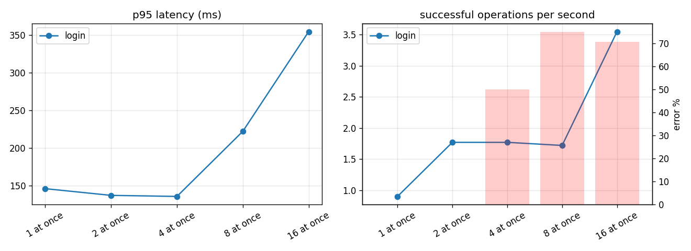
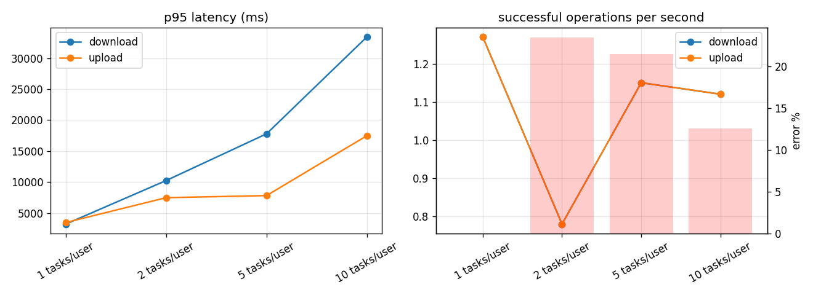
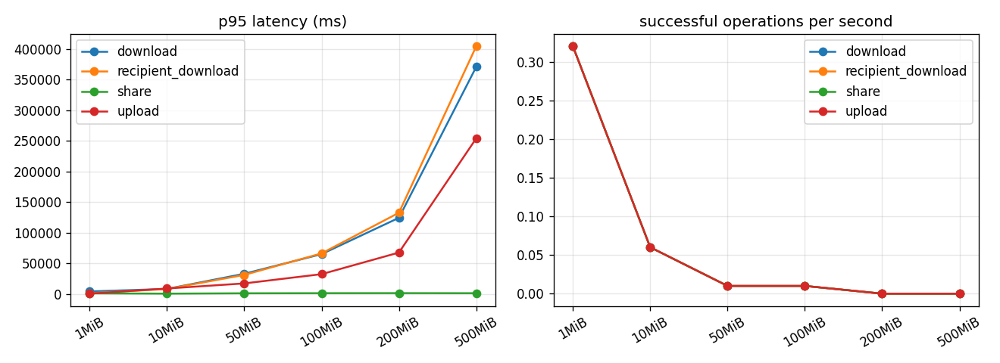
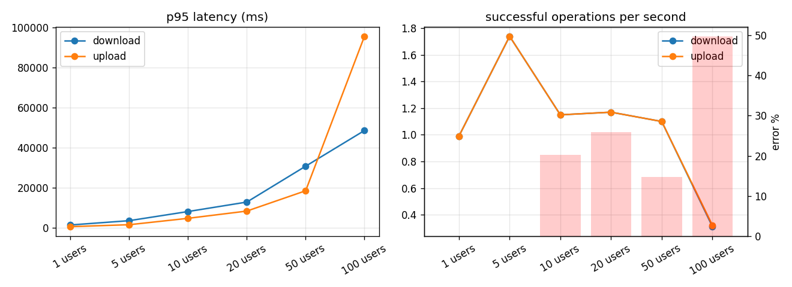
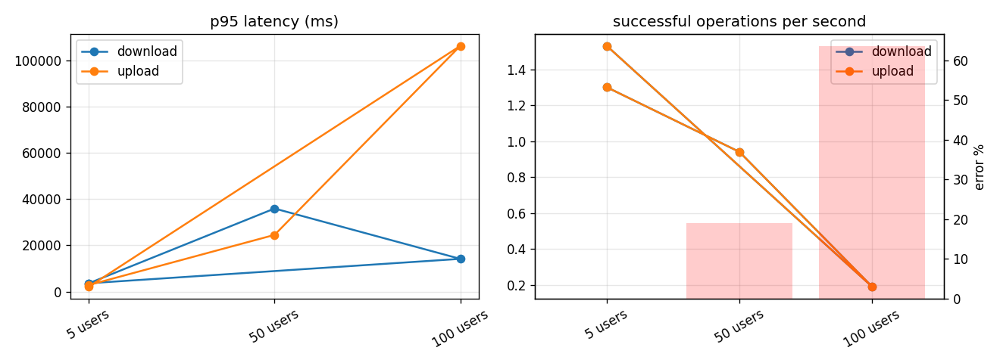

# SecureView load test report — staging, 2026-10-03/04

English | [简体中文](REPORT-2026-10-03.zh-CN.md)

Issue [#140](https://github.com/jsonrar/fyp-secure-file-platform/issues/140), meeting items 4–6.
Run 22:04 → 02:45 (+08) against `secureview.tech` staging at release `c041880` (includes the
#139 deadlock retry). Everything below the summary is generated by `secureview_load.report`
from the run's `summary.json` files and the server sampler CSV, both committed alongside.

## Summary

**Result: 22,264 operations, 5,094 downloads decrypted and SHA-256-compared with the original,
0 integrity failures.** No MySQL deadlock (1213) or lock-wait timeout (1205) appeared in the
backend log across all 28,540 requests the server handled that night.

| Question | Answer from this run |
| --- | --- |
| Large files (item 6) | Every type (pdf, png, jpg, mp4, zip, exe) at 1, 10, 50, 100, 200 and 500 MiB round-trips byte-exact: 144/144 operations, 72/72 downloads verified. A 500 MiB file took p50 **146 s up** and **295 s down** on the test link (below). |
| Stable load | 5 users on a 70/20/10 upload/download/share mix for **5 + 15 + 30 + 58 min**: 19,372 operations, 5 failures (all at the moment the generator's own network dropped). Upload p95 2.1–4.9 s, download p95 1.7–2.3 s. |
| Where it breaks | At **100 concurrent users** the API returns HTTP 500 for 65–78% of uploads: `QueuePool limit of size 5 overflow 10 reached, connection timed out, timeout 30.00`. Reproduced twice (22:20 and 02:42). Server CPU averaged 3% (peak 45%) and RAM stayed flat, so the limit is the **15-connection database pool of the single API process**, not the hardware. At 50 users there were 0 server errors. |
| Recovery | After the 100-user step the load dropped back to 5 users: **0 errors**, latency back to the first 5-user step. No restart, no manual action. |
| Sign-in | The server verifies **2 passwords at a time by design** (`AUTH_PASSWORD_HASH_CONCURRENCY=2`). With 4, 8 and 16 simultaneous sign-ins, 50%, 75% and 71% were answered immediately with HTTP 429 (p50 ~120 ms) for the client to retry. No 500s, no deadlocks. |
| Memory over time | API process RSS was 158–159 MiB for the whole run, including the 58-minute soak: no leak. |
| Monitoring | `mcs21-observe` emailed three alerts, each matching a deliberate step: 22:25 and 02:45 `unhandled_error_burst` (the two 100-user steps), 00:45 `auth_rate_limit_burst` (the sign-in test). Each cleared by itself on the next check. |

## Test conditions — read before quoting a number

- **Generator:** the load tool on a laptop on a home connection, reaching the API through an SSH
  tunnel to `127.0.0.1:8000` (no nginx, no TLS, so nginx's per-IP rate limits are not what was
  measured). The server's sshd forbids port forwarding; a root-only `PermitOpen 127.0.0.1:8000`
  exception was added for the run and removed afterwards.
- **The network, not the server, bounds every transfer figure.** Measured during the run: the
  VPS's own port does ~92–98 Mbit/s each way (to Cloudflare), but the home → VPS path gave
  ~24 Mbit/s up and ~13 Mbit/s down on one stream (41 Mbit/s with four). That is why aggregate
  throughput stays at ~1–3 ops/s from 5 users upward while the server sits at a few % CPU, and
  why latency grows with users. Large-file times are for this link; the server's own ceiling is
  its ~100 Mbit/s port (≥ ~45 s for 500 MiB).
- **`RemoteProtocolError` rows are client-side.** From 10 users (and 2+ tasks per user) some
  uploads fail with `RemoteProtocolError`. In the same windows the backend logged only 200/201
  responses and the observe job counted 0 server errors, so these are the single SSH tunnel
  dropping connections under load, not the application. 296 of the 510 failures are this.
- **Failure breakdown (510):** 296 tunnel-side `RemoteProtocolError`; 151 HTTP 500 from pool
  exhaustion at 100 users; 58 HTTP 429 from the sign-in cap (intended); 5 at the network drop.
- **The 60-minute soak is cut at 58 minutes.** The generator's home network dropped at 02:31:44;
  every request after that failed with `ConnectError` before reaching the server (the backend
  logged no error and did not restart). The summary keeps the 7,159 operations started before
  the drop; the untruncated file is `raw/mixed-20261003T173402Z/summary.untruncated.json`.
- **Latency drift in the soaks** (p95 rising after ~10–15 min) has no server-side counterpart:
  CPU, RSS, DB connections and error counts stayed flat. Two candidates, not separated by this
  run: the home link in the evening, and `list` getting slower as each test account accumulates
  thousands of files (list p95 336 ms in the 5-min run, 612 ms in the 58-min run).
- **Server was otherwise idle:** backups, offsite backup, reconcile, integrity sweep, security
  agent and auto-deploy timers were paused for the run; the backup and offsite backup were run
  by hand after cleanup, then every timer was restarted. All 100 test accounts and their files
  were deleted through the API (`cleanup`, 100 × HTTP 200); disk went 172 G → 192 G → 173 G.

## Findings to act on

1. **The DB pool is the first limit.** *Update 2026-10-04: the guess below was wrong, and it is
   fixed (PR #163).* Slow downloads hold no transaction while streaming; the cause was uploads
   holding a connection while awaiting a thread pool whose threads were waiting for connections.
   Locally the same 100-user step went from 80 % failed uploads at 0.33 ops/s to none at 56 ops/s;
   see [pool-fix-2026-10-04/](pool-fix-2026-10-04/README.md). The original guess, kept for the
   record: a request holds its database connection while a slow client is still sending or
   receiving the file body.
2. **The #139 retry is not observable.** `app/core/db_retry.py` does not log when it retries, so
   this run can say no deadlock reached a user, but not whether any retry fired. A one-line
   warning log on retry would make the next run answer that. *Update 2026-10-08: added in PR #202.*

## logins — `logins-20261003T164323Z`

Target `http://127.0.0.1:18000/api/v1`, algorithm AES-256-GCM. Request times are measured at the client and include the network; crypto times are the client's own encryption or decryption (the server never decrypts).

| Step | Op | n | ok | error % | p50 ms | p95 ms | p99 ms | ops/s | MiB/s | crypto p50 ms | errors |
|---|---|---:|---:|---:|---:|---:|---:|---:|---:|---:|---|
| 1 at once | login | 3 | 3 | 0.0 | 97 | 146 | 146 | 0.90 | 0.00 | - |  |
| 2 at once | login | 6 | 6 | 0.0 | 124 | 137 | 137 | 1.77 | 0.00 | - |  |
| 4 at once | login | 12 | 6 | 50.0 | 128 | 136 | 136 | 1.77 | 0.00 | - | http_429 x6 |
| 8 at once | login | 24 | 6 | 75.0 | 123 | 222 | 222 | 1.72 | 0.00 | - | http_429 x18 |
| 16 at once | login | 48 | 14 | 70.8 | 258 | 354 | 354 | 3.55 | 0.00 | - | http_429 x34 |

Server during each step (mean / peak):

| Step | CPU % | iowait % | RAM used MiB | API proc CPU % | API RSS MiB | MySQL CPU % | DB conns | disk write MB/s | net rx MB/s | net tx MB/s |
|---|---:|---:|---:|---:|---:|---:|---:|---:|---:|---:|
| 1 at once | 3.2 / 3.8 | 0.1 / 0.1 | 4937.0 / 4938.0 | 0.2 / 0.5 | 158.0 / 158.0 | 0.8 / 1.0 | 15.0 / 15.0 | 0.5 / 0.6 | 0.0 / 0.0 | 0.0 / 0.0 |
| 2 at once | 6.5 / 7.0 | 0.1 / 0.1 | 4867.0 / 4912.0 | 0.0 / 0.0 | 158.0 / 158.0 | 1.5 / 2.0 | 15.0 / 15.0 | 2.2 / 4.0 | 0.0 / 0.0 | 0.0 / 0.0 |
| 4 at once | 6.0 / 7.5 | 0.1 / 0.1 | 4937.5 / 4960.0 | 0.2 / 0.5 | 158.0 / 158.0 | 1.8 / 2.0 | 15.0 / 15.0 | 0.4 / 0.6 | 0.0 / 0.0 | 0.0 / 0.0 |
| 8 at once | 7.1 / 7.6 | 0.1 / 0.1 | 5019.0 / 5034.0 | 0.5 / 1.0 | 158.0 / 158.0 | 2.5 / 3.0 | 15.0 / 15.0 | 1.2 / 2.0 | 0.0 / 0.0 | 0.0 / 0.0 |
| 16 at once | 13.3 / 18.5 | 0.2 / 0.2 | 4964.5 / 4969.0 | 0.2 / 0.5 | 158.0 / 158.0 | 5.7 / 7.4 | 16.5 / 18.0 | 3.7 / 6.1 | 0.0 / 0.0 | 0.0 / 0.0 |

## mixed — `mixed-20261003T164352Z`

Target `http://127.0.0.1:18000/api/v1`, algorithm AES-256-GCM. Request times are measured at the client and include the network; crypto times are the client's own encryption or decryption (the server never decrypts).

Sign-in (Argon2id on the server): p50 134 ms, p95 1053 ms over 5 sign-ins.

| Step | Op | n | ok | error % | p50 ms | p95 ms | p99 ms | ops/s | MiB/s | crypto p50 ms | errors |
|---|---|---:|---:|---:|---:|---:|---:|---:|---:|---:|---|
| mixed 5 users | download | 254 | 254 | 0.0 | 909 | 2310 | 3737 | 0.84 | 0.84 | 9 |  |
| mixed 5 users | list | 73 | 73 | 0.0 | 144 | 336 | 415 | 0.24 | 0.00 | - |  |
| mixed 5 users | share | 74 | 74 | 0.0 | 275 | 732 | 1238 | 0.25 | 0.00 | - |  |
| mixed 5 users | upload | 907 | 907 | 0.0 | 1264 | 2061 | 2475 | 3.02 | 3.02 | 1 |  |

Server during each step (mean / peak):

| Step | CPU % | iowait % | RAM used MiB | API proc CPU % | API RSS MiB | MySQL CPU % | DB conns | disk write MB/s | net rx MB/s | net tx MB/s |
|---|---:|---:|---:|---:|---:|---:|---:|---:|---:|---:|
| mixed 5 users | 3.5 / 9.7 | 0.2 / 0.9 | 4748.7 / 4832.0 | 0.2 / 1.5 | 158.0 / 158.0 | 2.7 / 5.0 | 15.0 / 15.0 | 4.6 / 16.4 | 3.3 / 5.3 | 1.0 / 2.6 |

Time series for mixed 5 users (per window):

| t (s) | ops | errors | p95 ms | ops/s |
|---:|---:|---:|---:|---:|
| 0.0 | 138 | 0 | 1796 | 4.6 |
| 30.0 | 107 | 0 | 2112 | 3.57 |
| 60.0 | 100 | 0 | 2585 | 3.33 |
| 90.0 | 112 | 0 | 2713 | 3.73 |
| 120.0 | 154 | 0 | 1353 | 5.13 |
| 150.0 | 125 | 0 | 2172 | 4.17 |
| 180.0 | 137 | 0 | 1649 | 4.57 |
| 210.0 | 148 | 0 | 1650 | 4.93 |
| 240.0 | 144 | 0 | 1832 | 4.8 |
| 270.0 | 143 | 0 | 1662 | 4.77 |

## mixed — `mixed-20261003T164856Z`

Target `http://127.0.0.1:18000/api/v1`, algorithm AES-256-GCM. Request times are measured at the client and include the network; crypto times are the client's own encryption or decryption (the server never decrypts).

Sign-in (Argon2id on the server): p50 108 ms, p95 631 ms over 5 sign-ins.

| Step | Op | n | ok | error % | p50 ms | p95 ms | p99 ms | ops/s | MiB/s | crypto p50 ms | errors |
|---|---|---:|---:|---:|---:|---:|---:|---:|---:|---:|---|
| mixed 5 users | download | 796 | 796 | 0.0 | 843 | 1704 | 2288 | 0.88 | 0.88 | 9 |  |
| mixed 5 users | list | 215 | 215 | 0.0 | 152 | 382 | 488 | 0.24 | 0.00 | - |  |
| mixed 5 users | share | 217 | 217 | 0.0 | 317 | 612 | 803 | 0.24 | 0.00 | - |  |
| mixed 5 users | upload | 2798 | 2798 | 0.0 | 1216 | 2143 | 2608 | 3.11 | 3.11 | 1 |  |

Server during each step (mean / peak):

| Step | CPU % | iowait % | RAM used MiB | API proc CPU % | API RSS MiB | MySQL CPU % | DB conns | disk write MB/s | net rx MB/s | net tx MB/s |
|---|---:|---:|---:|---:|---:|---:|---:|---:|---:|---:|
| mixed 5 users | 3.6 / 11.2 | 0.2 / 0.8 | 4723.9 / 4894.0 | 0.2 / 2.0 | 158.0 / 158.0 | 3.2 / 7.9 | 15.0 / 15.0 | 4.9 / 17.7 | 3.4 / 5.9 | 1.0 / 2.6 |

Time series for mixed 5 users (per window):

| t (s) | ops | errors | p95 ms | ops/s |
|---:|---:|---:|---:|---:|
| 0.0 | 283 | 0 | 1926 | 4.72 |
| 60.0 | 292 | 0 | 1491 | 4.87 |
| 120.0 | 257 | 0 | 1985 | 4.28 |
| 180.0 | 283 | 0 | 1741 | 4.72 |
| 240.0 | 212 | 0 | 2583 | 3.53 |
| 300.0 | 235 | 0 | 2092 | 3.92 |
| 360.0 | 191 | 0 | 2533 | 3.18 |
| 420.0 | 295 | 0 | 1522 | 4.92 |
| 480.0 | 305 | 0 | 1698 | 5.08 |
| 540.0 | 267 | 0 | 2216 | 4.45 |
| 600.0 | 242 | 0 | 2436 | 4.03 |
| 660.0 | 304 | 0 | 1433 | 5.07 |
| 720.0 | 306 | 0 | 1611 | 5.1 |
| 780.0 | 256 | 0 | 1811 | 4.27 |
| 840.0 | 298 | 0 | 1531 | 4.97 |

## mixed — `mixed-20261003T170359Z`

Target `http://127.0.0.1:18000/api/v1`, algorithm AES-256-GCM. Request times are measured at the client and include the network; crypto times are the client's own encryption or decryption (the server never decrypts).

Sign-in (Argon2id on the server): p50 140 ms, p95 604 ms over 5 sign-ins.

| Step | Op | n | ok | error % | p50 ms | p95 ms | p99 ms | ops/s | MiB/s | crypto p50 ms | errors |
|---|---|---:|---:|---:|---:|---:|---:|---:|---:|---:|---|
| mixed 5 users | download | 1430 | 1430 | 0.0 | 961 | 1927 | 2629 | 0.79 | 0.79 | 9 |  |
| mixed 5 users | list | 359 | 359 | 0.0 | 211 | 441 | 681 | 0.20 | 0.00 | - |  |
| mixed 5 users | share | 374 | 374 | 0.0 | 354 | 718 | 1101 | 0.21 | 0.00 | - |  |
| mixed 5 users | upload | 4716 | 4716 | 0.0 | 1423 | 2597 | 3258 | 2.62 | 2.62 | 1 |  |

Server during each step (mean / peak):

| Step | CPU % | iowait % | RAM used MiB | API proc CPU % | API RSS MiB | MySQL CPU % | DB conns | disk write MB/s | net rx MB/s | net tx MB/s |
|---|---:|---:|---:|---:|---:|---:|---:|---:|---:|---:|
| mixed 5 users | 3.7 / 18.4 | 0.2 / 4.9 | 4729.9 / 5263.0 | 0.2 / 1.5 | 158.0 / 158.0 | 3.5 / 11.4 | 15.0 / 15.0 | 4.5 / 14.4 | 2.9 / 6.2 | 0.9 / 2.7 |

Time series for mixed 5 users (per window):

| t (s) | ops | errors | p95 ms | ops/s |
|---:|---:|---:|---:|---:|
| 0.0 | 330 | 0 | 1482 | 5.5 |
| 60.0 | 319 | 0 | 1393 | 5.32 |
| 120.0 | 327 | 0 | 1391 | 5.45 |
| 180.0 | 314 | 0 | 1465 | 5.23 |
| 240.0 | 318 | 0 | 1458 | 5.3 |
| 300.0 | 299 | 0 | 1598 | 4.98 |
| 360.0 | 304 | 0 | 1575 | 5.07 |
| 420.0 | 331 | 0 | 1406 | 5.52 |
| 480.0 | 319 | 0 | 1549 | 5.32 |
| 540.0 | 277 | 0 | 1900 | 4.62 |
| 600.0 | 202 | 0 | 2597 | 3.37 |
| 660.0 | 239 | 0 | 1887 | 3.98 |
| 720.0 | 228 | 0 | 2031 | 3.8 |
| 780.0 | 213 | 0 | 2105 | 3.55 |
| 840.0 | 183 | 0 | 3043 | 3.05 |
| 900.0 | 141 | 0 | 4530 | 2.35 |
| 960.0 | 173 | 0 | 2937 | 2.88 |
| 1020.0 | 183 | 0 | 2616 | 3.05 |
| 1080.0 | 210 | 0 | 2401 | 3.5 |
| 1140.0 | 183 | 0 | 2768 | 3.05 |
| 1200.0 | 192 | 0 | 2436 | 3.2 |
| 1260.0 | 175 | 0 | 3113 | 2.92 |
| 1320.0 | 162 | 0 | 2697 | 2.7 |
| 1380.0 | 180 | 0 | 2551 | 3.0 |
| 1440.0 | 195 | 0 | 2553 | 3.25 |
| 1500.0 | 194 | 0 | 2528 | 3.23 |
| 1560.0 | 187 | 0 | 2642 | 3.12 |
| 1620.0 | 182 | 0 | 2560 | 3.03 |
| 1680.0 | 152 | 0 | 3027 | 2.53 |
| 1740.0 | 167 | 0 | 3291 | 2.78 |

## mixed — `mixed-20261003T173402Z`

Target `http://127.0.0.1:18000/api/v1`, algorithm AES-256-GCM. Request times are measured at the client and include the network; crypto times are the client's own encryption or decryption (the server never decrypts).

Sign-in (Argon2id on the server): p50 127 ms, p95 605 ms over 5 sign-ins.

| Step | Op | n | ok | error % | p50 ms | p95 ms | p99 ms | ops/s | MiB/s | crypto p50 ms | errors |
|---|---|---:|---:|---:|---:|---:|---:|---:|---:|---:|---|
| mixed 5 users (soak, first 58 min) | download | 1439 | 1439 | 0.0 | 1190 | 1965 | 2492 | 0.42 | 0.42 | 9 |  |
| mixed 5 users (soak, first 58 min) | list | 388 | 388 | 0.0 | 316 | 612 | 778 | 0.11 | 0.00 | - |  |
| mixed 5 users (soak, first 58 min) | share | 369 | 369 | 0.0 | 582 | 1050 | 1418 | 0.11 | 0.00 | - |  |
| mixed 5 users (soak, first 58 min) | upload | 4963 | 4958 | 0.1 | 2775 | 4946 | 6368 | 1.43 | 1.43 | 1 | RemoteProtocolError x5 |

Server during each step (mean / peak):

| Step | CPU % | iowait % | RAM used MiB | API proc CPU % | API RSS MiB | MySQL CPU % | DB conns | disk write MB/s | net rx MB/s | net tx MB/s |
|---|---:|---:|---:|---:|---:|---:|---:|---:|---:|---:|
| mixed 5 users (soak, first 58 min) | 2.9 / 16.7 | 0.1 / 1.4 | 4809.8 / 5306.0 | 0.2 / 6.0 | 158.0 / 158.0 | 2.7 / 16.9 | 15.0 / 15.0 | 3.1 / 17.5 | 1.6 / 3.8 | 0.5 / 2.4 |

Time series for mixed 5 users (soak, first 58 min) (per window):

| t (s) | ops | errors | p95 ms | ops/s |
|---:|---:|---:|---:|---:|
| 0.0 | 160 | 0 | 3436 | 2.67 |
| 60.0 | 160 | 0 | 2734 | 2.67 |
| 120.0 | 165 | 0 | 3178 | 2.75 |
| 180.0 | 163 | 0 | 2786 | 2.72 |
| 240.0 | 185 | 0 | 2549 | 3.08 |
| 300.0 | 170 | 0 | 2719 | 2.83 |
| 360.0 | 175 | 0 | 2588 | 2.92 |
| 420.0 | 184 | 0 | 2784 | 3.07 |
| 480.0 | 212 | 0 | 2450 | 3.53 |
| 540.0 | 191 | 0 | 2542 | 3.18 |
| 600.0 | 181 | 0 | 2589 | 3.02 |
| 660.0 | 161 | 0 | 3158 | 2.68 |
| 720.0 | 161 | 0 | 3373 | 2.68 |
| 780.0 | 183 | 0 | 2662 | 3.05 |
| 840.0 | 124 | 0 | 5460 | 2.07 |
| 900.0 | 82 | 0 | 5746 | 1.37 |
| 960.0 | 89 | 0 | 6070 | 1.48 |
| 1020.0 | 114 | 0 | 5242 | 1.9 |
| 1080.0 | 70 | 0 | 10612 | 1.17 |
| 1140.0 | 102 | 0 | 4642 | 1.7 |
| 1200.0 | 92 | 0 | 5646 | 1.53 |
| 1260.0 | 104 | 0 | 4298 | 1.73 |
| 1320.0 | 91 | 0 | 5142 | 1.52 |
| 1380.0 | 105 | 0 | 4946 | 1.75 |
| 1440.0 | 128 | 0 | 4137 | 2.13 |
| 1500.0 | 122 | 0 | 4266 | 2.03 |
| 1560.0 | 87 | 0 | 7160 | 1.45 |
| 1620.0 | 117 | 0 | 5315 | 1.95 |
| 1680.0 | 102 | 0 | 5642 | 1.7 |
| 1740.0 | 112 | 0 | 4344 | 1.87 |
| 1800.0 | 122 | 0 | 4971 | 2.03 |
| 1860.0 | 104 | 0 | 4532 | 1.73 |
| 1920.0 | 106 | 0 | 5381 | 1.77 |
| 1980.0 | 121 | 0 | 4174 | 2.02 |
| 2040.0 | 102 | 0 | 4702 | 1.7 |
| 2100.0 | 123 | 0 | 3606 | 2.05 |
| 2160.0 | 109 | 0 | 4657 | 1.82 |
| 2220.0 | 112 | 0 | 4071 | 1.87 |
| 2280.0 | 129 | 0 | 3809 | 2.15 |
| 2340.0 | 124 | 0 | 4164 | 2.07 |
| 2400.0 | 132 | 0 | 4130 | 2.2 |
| 2460.0 | 122 | 0 | 3586 | 2.03 |
| 2520.0 | 138 | 0 | 3571 | 2.3 |
| 2580.0 | 173 | 0 | 2740 | 2.88 |
| 2640.0 | 151 | 0 | 3384 | 2.52 |
| 2700.0 | 137 | 0 | 3772 | 2.28 |
| 2760.0 | 119 | 0 | 4696 | 1.98 |
| 2820.0 | 96 | 0 | 5778 | 1.6 |
| 2880.0 | 110 | 0 | 5076 | 1.83 |
| 2940.0 | 108 | 0 | 4322 | 1.8 |
| 3000.0 | 139 | 0 | 3469 | 2.32 |
| 3060.0 | 119 | 0 | 4312 | 1.98 |
| 3120.0 | 104 | 0 | 5023 | 1.73 |
| 3180.0 | 85 | 0 | 5585 | 1.42 |
| 3240.0 | 85 | 0 | 5734 | 1.42 |
| 3300.0 | 81 | 0 | 8060 | 1.35 |
| 3360.0 | 16 | 5 | 5197 | 0.18 |

## parallel — `parallel-20261003T163737Z`

Target `http://127.0.0.1:18000/api/v1`, algorithm AES-256-GCM. Request times are measured at the client and include the network; crypto times are the client's own encryption or decryption (the server never decrypts).

Sign-in (Argon2id on the server): p50 116 ms, p95 619 ms over 5 sign-ins.

| Step | Op | n | ok | error % | p50 ms | p95 ms | p99 ms | ops/s | MiB/s | crypto p50 ms | errors |
|---|---|---:|---:|---:|---:|---:|---:|---:|---:|---:|---|
| 1 tasks/user | download | 83 | 83 | 0.0 | 2150 | 3233 | 4064 | 1.27 | 1.27 | 9 |  |
| 1 tasks/user | upload | 83 | 83 | 0.0 | 1446 | 3487 | 3813 | 1.27 | 1.27 | 1 |  |
| 2 tasks/user | download | 57 | 57 | 0.0 | 8226 | 10255 | 10279 | 0.78 | 0.78 | 9 |  |
| 2 tasks/user | upload | 92 | 57 | 38.0 | 5805 | 7493 | 7516 | 0.78 | 0.78 | 2 | RemoteProtocolError x35 |
| 5 tasks/user | download | 84 | 84 | 0.0 | 15705 | 17787 | 17849 | 1.15 | 1.15 | 8 |  |
| 5 tasks/user | upload | 130 | 84 | 35.4 | 7391 | 7825 | 7879 | 1.15 | 1.15 | 4 | RemoteProtocolError x46 |
| 10 tasks/user | download | 104 | 104 | 0.0 | 26653 | 33422 | 33474 | 1.12 | 1.12 | 8 |  |
| 10 tasks/user | upload | 134 | 104 | 22.4 | 15772 | 17487 | 17717 | 1.12 | 1.12 | 17 | RemoteProtocolError x30 |

Server during each step (mean / peak):

| Step | CPU % | iowait % | RAM used MiB | API proc CPU % | API RSS MiB | MySQL CPU % | DB conns | disk write MB/s | net rx MB/s | net tx MB/s |
|---|---:|---:|---:|---:|---:|---:|---:|---:|---:|---:|
| 1 tasks/user | 2.7 / 8.4 | 0.1 / 0.4 | 4793.5 / 4881.0 | 0.2 / 1.5 | 158.0 / 158.0 | 1.8 / 3.0 | 15.0 / 15.0 | 2.1 / 4.3 | 1.4 / 2.8 | 1.4 / 2.3 |
| 2 tasks/user | 2.2 / 5.2 | 0.1 / 0.4 | 4793.1 / 4944.0 | 0.3 / 1.5 | 158.0 / 158.0 | 1.3 / 5.0 | 15.0 / 15.0 | 1.7 / 8.5 | 1.0 / 2.7 | 0.9 / 1.8 |
| 5 tasks/user | 2.8 / 11.3 | 0.1 / 1.0 | 4912.8 / 4943.0 | 0.2 / 1.0 | 158.0 / 158.0 | 1.8 / 14.9 | 15.0 / 15.0 | 2.3 / 19.1 | 1.5 / 4.3 | 1.3 / 2.2 |
| 10 tasks/user | 2.8 / 15.1 | 0.1 / 1.5 | 4926.0 / 4973.0 | 0.2 / 1.0 | 158.0 / 158.0 | 1.6 / 18.8 | 16.0 / 45.0 | 2.0 / 20.8 | 1.3 / 5.1 | 1.2 / 2.4 |

## sizes — `sizes-20261003T142157Z`

Target `http://127.0.0.1:18000/api/v1`, algorithm AES-256-GCM. Request times are measured at the client and include the network; crypto times are the client's own encryption or decryption (the server never decrypts).

Sign-in (Argon2id on the server): p50 122 ms, p95 262 ms over 2 sign-ins.

| Step | Op | n | ok | error % | p50 ms | p95 ms | p99 ms | ops/s | MiB/s | crypto p50 ms | errors |
|---|---|---:|---:|---:|---:|---:|---:|---:|---:|---:|---|
| 1MiB | download | 6 | 6 | 0.0 | 676 | 4070 | 4070 | 0.32 | 0.32 | 9 |  |
| 1MiB | recipient_download | 6 | 6 | 0.0 | 678 | 1293 | 1293 | 0.32 | 0.32 | 9 |  |
| 1MiB | share | 6 | 6 | 0.0 | 369 | 1011 | 1011 | 0.32 | 0.00 | - |  |
| 1MiB | upload | 6 | 6 | 0.0 | 304 | 458 | 458 | 0.32 | 0.32 | 1 |  |
| 10MiB | download | 6 | 6 | 0.0 | 5902 | 8188 | 8188 | 0.06 | 0.55 | 16 |  |
| 10MiB | recipient_download | 6 | 6 | 0.0 | 7252 | 7986 | 7986 | 0.06 | 0.55 | 15 |  |
| 10MiB | share | 6 | 6 | 0.0 | 350 | 479 | 479 | 0.06 | 0.00 | - |  |
| 10MiB | upload | 6 | 6 | 0.0 | 2926 | 8863 | 8863 | 0.06 | 0.55 | 2 |  |
| 50MiB | download | 6 | 6 | 0.0 | 29721 | 32920 | 32920 | 0.01 | 0.65 | 35 |  |
| 50MiB | recipient_download | 6 | 6 | 0.0 | 30327 | 31044 | 31044 | 0.01 | 0.65 | 32 |  |
| 50MiB | share | 6 | 6 | 0.0 | 814 | 1061 | 1061 | 0.01 | 0.00 | - |  |
| 50MiB | upload | 6 | 6 | 0.0 | 13982 | 17175 | 17175 | 0.01 | 0.65 | 8 |  |
| 100MiB | download | 6 | 6 | 0.0 | 62970 | 64959 | 64959 | 0.01 | 0.64 | 76 |  |
| 100MiB | recipient_download | 6 | 6 | 0.0 | 61061 | 66195 | 66195 | 0.01 | 0.64 | 76 |  |
| 100MiB | share | 6 | 6 | 0.0 | 925 | 1215 | 1215 | 0.01 | 0.00 | - |  |
| 100MiB | upload | 6 | 6 | 0.0 | 30870 | 32301 | 32301 | 0.01 | 0.64 | 14 |  |
| 200MiB | download | 6 | 6 | 0.0 | 120313 | 124219 | 124219 | 0.00 | 0.66 | 112 |  |
| 200MiB | recipient_download | 6 | 6 | 0.0 | 119236 | 132484 | 132484 | 0.00 | 0.66 | 110 |  |
| 200MiB | share | 6 | 6 | 0.0 | 1161 | 1300 | 1300 | 0.00 | 0.00 | - |  |
| 200MiB | upload | 6 | 6 | 0.0 | 60495 | 67531 | 67531 | 0.00 | 0.66 | 29 |  |
| 500MiB | download | 6 | 6 | 0.0 | 295153 | 370544 | 370544 | 0.00 | 0.63 | 471 |  |
| 500MiB | recipient_download | 6 | 6 | 0.0 | 300874 | 404158 | 404158 | 0.00 | 0.63 | 542 |  |
| 500MiB | share | 6 | 6 | 0.0 | 1042 | 1192 | 1192 | 0.00 | 0.00 | - |  |
| 500MiB | upload | 6 | 6 | 0.0 | 146021 | 253869 | 253869 | 0.00 | 0.63 | 85 |  |

Server during each step (mean / peak):

| Step | CPU % | iowait % | RAM used MiB | API proc CPU % | API RSS MiB | MySQL CPU % | DB conns | disk write MB/s | net rx MB/s | net tx MB/s |
|---|---:|---:|---:|---:|---:|---:|---:|---:|---:|---:|
| 1MiB | 2.0 / 3.9 | 0.1 / 0.1 | 4762.7 / 4775.0 | 0.1 / 0.5 | 159.0 / 159.0 | 1.2 / 2.0 | 15.0 / 15.0 | 1.3 / 4.3 | 0.3 / 0.6 | 0.7 / 1.1 |
| 10MiB | 1.8 / 4.4 | 0.0 / 0.1 | 4767.0 / 4805.0 | 0.2 / 1.5 | 159.0 / 159.0 | 0.6 / 1.5 | 15.0 / 15.0 | 0.9 / 6.6 | 0.7 / 4.4 | 1.2 / 2.1 |
| 50MiB | 1.7 / 4.3 | 0.0 / 0.4 | 4764.7 / 4823.0 | 0.2 / 1.5 | 159.0 / 159.0 | 0.5 / 1.5 | 15.0 / 15.0 | 1.1 / 27.5 | 0.8 / 5.8 | 1.4 / 2.5 |
| 100MiB | 1.7 / 6.0 | 0.0 / 0.8 | 4807.9 / 5036.0 | 0.2 / 1.0 | 159.0 / 159.0 | 0.4 / 1.5 | 15.0 / 15.0 | 1.1 / 78.3 | 0.7 / 5.2 | 1.4 / 2.4 |
| 200MiB | 1.7 / 6.9 | 0.0 / 1.3 | 4767.9 / 4930.0 | 0.2 / 1.5 | 159.0 / 159.0 | 0.4 / 1.5 | 15.0 / 15.0 | 1.2 / 146.8 | 0.8 / 7.7 | 1.5 / 7.3 |
| 500MiB | 1.7 / 12.0 | 0.0 / 3.5 | 4802.7 / 4978.0 | 0.2 / 4.5 | 158.6 / 159.0 | 0.4 / 1.5 | 15.0 / 15.0 | 1.3 / 263.8 | 0.7 / 5.5 | 1.4 / 2.5 |

## smoke — `smoke-20261003T141210Z`

Target `http://127.0.0.1:18000/api/v1`, algorithm AES-256-GCM. Request times are measured at the client and include the network; crypto times are the client's own encryption or decryption (the server never decrypts).

Sign-in (Argon2id on the server): p50 189 ms, p95 338 ms over 2 sign-ins.

| Step | Op | n | ok | error % | p50 ms | p95 ms | p99 ms | ops/s | MiB/s | crypto p50 ms | errors |
|---|---|---:|---:|---:|---:|---:|---:|---:|---:|---:|---|
| 64KiB | download | 1 | 1 | 0.0 | 75 | 75 | 75 | 1.04 | 0.07 | 12 |  |
| 64KiB | recipient_download | 1 | 1 | 0.0 | 60 | 60 | 60 | 1.04 | 0.07 | 14 |  |
| 64KiB | share | 1 | 1 | 0.0 | 702 | 702 | 702 | 1.04 | 0.00 | - |  |
| 64KiB | upload | 1 | 1 | 0.0 | 88 | 88 | 88 | 1.04 | 0.07 | 5 |  |

## steps — `steps-20261003T141247Z`

Target `http://127.0.0.1:18000/api/v1`, algorithm AES-256-GCM. Request times are measured at the client and include the network; crypto times are the client's own encryption or decryption (the server never decrypts).

Sign-in (Argon2id on the server): p50 114 ms, p95 1092 ms over 100 sign-ins.

| Step | Op | n | ok | error % | p50 ms | p95 ms | p99 ms | ops/s | MiB/s | crypto p50 ms | errors |
|---|---|---:|---:|---:|---:|---:|---:|---:|---:|---:|---|
| 1 users | download | 60 | 60 | 0.0 | 506 | 1526 | 1674 | 0.99 | 0.99 | 9 |  |
| 1 users | upload | 60 | 60 | 0.0 | 322 | 694 | 1209 | 0.99 | 0.99 | 1 |  |
| 5 users | download | 107 | 107 | 0.0 | 1813 | 3681 | 3724 | 1.74 | 1.74 | 9 |  |
| 5 users | upload | 107 | 107 | 0.0 | 814 | 1662 | 1735 | 1.74 | 1.74 | 1 |  |
| 10 users | download | 73 | 73 | 0.0 | 5668 | 8240 | 8302 | 1.15 | 1.15 | 10 |  |
| 10 users | upload | 110 | 73 | 33.6 | 3369 | 4852 | 5260 | 1.15 | 1.15 | 2 | RemoteProtocolError x37 |
| 20 users | download | 89 | 89 | 0.0 | 11871 | 12971 | 13185 | 1.17 | 1.17 | 12 |  |
| 20 users | upload | 151 | 89 | 41.1 | 5800 | 8472 | 8475 | 1.17 | 1.17 | 3 | RemoteProtocolError x62 |
| 50 users | download | 104 | 104 | 0.0 | 27968 | 30880 | 30908 | 1.10 | 1.10 | 9 |  |
| 50 users | upload | 140 | 104 | 25.7 | 18022 | 18607 | 18699 | 1.10 | 1.10 | 13 | RemoteProtocolError x36 |
| 100 users | download | 37 | 35 | 5.4 | 18523 | 48696 | 71634 | 0.31 | 0.31 | 9 | http_500 x2 |
| 100 users | upload | 106 | 37 | 65.1 | 68183 | 95730 | 95730 | 0.32 | 0.32 | 40 | http_500 x69 |

Server during each step (mean / peak):

| Step | CPU % | iowait % | RAM used MiB | API proc CPU % | API RSS MiB | MySQL CPU % | DB conns | disk write MB/s | net rx MB/s | net tx MB/s |
|---|---:|---:|---:|---:|---:|---:|---:|---:|---:|---:|
| 1 users | 2.3 / 3.6 | 0.1 / 0.3 | 4475.1 / 4490.0 | 0.2 / 1.0 | 159.0 / 159.0 | 1.4 / 2.5 | 6.0 / 6.0 | 2.0 / 4.9 | 1.1 / 1.7 | 1.1 / 1.7 |
| 5 users | 3.3 / 7.5 | 0.2 / 0.2 | 4503.5 / 4537.0 | 0.2 / 1.0 | 159.0 / 159.0 | 2.3 / 4.0 | 11.8 / 12.0 | 3.0 / 6.2 | 1.9 / 3.3 | 1.9 / 2.7 |
| 10 users | 3.0 / 11.1 | 0.1 / 0.6 | 4535.7 / 4600.0 | 0.2 / 1.0 | 159.0 / 159.0 | 1.8 / 6.0 | 14.8 / 15.0 | 2.4 / 8.6 | 1.4 / 3.7 | 1.3 / 2.4 |
| 20 users | 2.7 / 8.3 | 0.1 / 0.7 | 4625.3 / 4768.0 | 0.2 / 1.0 | 159.0 / 159.0 | 1.8 / 11.4 | 16.6 / 45.0 | 2.5 / 15.3 | 1.5 / 5.2 | 1.3 / 2.3 |
| 50 users | 3.3 / 28.6 | 0.1 / 2.1 | 4776.0 / 5057.0 | 0.2 / 1.5 | 159.0 / 159.0 | 1.6 / 21.3 | 15.8 / 45.0 | 2.2 / 35.1 | 1.3 / 4.8 | 1.2 / 2.2 |
| 100 users | 3.0 / 43.3 | 0.0 / 0.7 | 4809.2 / 5143.0 | 0.2 / 1.0 | 159.0 / 159.0 | 0.9 / 9.9 | 30.8 / 45.0 | 0.8 / 14.3 | 1.0 / 4.5 | 0.3 / 2.2 |

## steps — `steps-20261003T183807Z`

Target `http://127.0.0.1:18000/api/v1`, algorithm AES-256-GCM. Request times are measured at the client and include the network; crypto times are the client's own encryption or decryption (the server never decrypts).

Sign-in (Argon2id on the server): p50 120 ms, p95 463 ms over 100 sign-ins.

| Step | Op | n | ok | error % | p50 ms | p95 ms | p99 ms | ops/s | MiB/s | crypto p50 ms | errors |
|---|---|---:|---:|---:|---:|---:|---:|---:|---:|---:|---|
| 5 users | download | 81 | 81 | 0.0 | 2506 | 3594 | 3841 | 1.30 | 1.30 | 9 |  |
| 5 users | upload | 81 | 81 | 0.0 | 1451 | 2835 | 2983 | 1.30 | 1.30 | 1 |  |
| 50 users | download | 106 | 106 | 0.0 | 31639 | 35926 | 35943 | 0.94 | 0.94 | 12 |  |
| 50 users | upload | 156 | 106 | 32.0 | 21504 | 24525 | 24721 | 0.94 | 0.94 | 20 | RemoteProtocolError x50 |
| 100 users | download | 23 | 23 | 0.0 | 13989 | 14151 | 74208 | 0.19 | 0.19 | 15 |  |
| 100 users | upload | 103 | 23 | 77.7 | 106154 | 106254 | 106360 | 0.19 | 0.19 | 49 | http_500 x80 |
| 5 users | download | 95 | 95 | 0.0 | 2344 | 3592 | 4597 | 1.53 | 1.53 | 9 |  |
| 5 users | upload | 95 | 95 | 0.0 | 953 | 2122 | 2479 | 1.53 | 1.53 | 1 |  |

Server during each step (mean / peak):

| Step | CPU % | iowait % | RAM used MiB | API proc CPU % | API RSS MiB | MySQL CPU % | DB conns | disk write MB/s | net rx MB/s | net tx MB/s |
|---|---:|---:|---:|---:|---:|---:|---:|---:|---:|---:|
| 5 users | 3.0 / 8.5 | 0.2 / 0.4 | 4693.2 / 4822.0 | 0.3 / 1.0 | 158.0 / 158.0 | 3.7 / 7.0 | 15.0 / 15.0 | 2.6 / 10.7 | 1.5 / 2.7 | 1.4 / 2.1 |
| 50 users | 3.1 / 28.0 | 0.1 / 1.3 | 4757.7 / 5001.0 | 0.2 / 1.5 | 158.0 / 158.0 | 1.5 / 14.9 | 15.9 / 45.0 | 1.9 / 28.6 | 1.1 / 3.4 | 1.0 / 2.0 |
| 100 users | 2.9 / 44.9 | 0.0 / 0.9 | 4781.3 / 5125.0 | 0.2 / 1.0 | 158.0 / 158.0 | 0.8 / 8.9 | 30.0 / 45.0 | 0.6 / 11.8 | 0.9 / 4.1 | 0.2 / 1.8 |
| 5 users | 3.5 / 9.6 | 0.1 / 0.3 | 4718.9 / 4769.0 | 0.3 / 1.0 | 158.0 / 158.0 | 4.0 / 7.5 | 15.0 / 15.0 | 3.0 / 13.8 | 1.7 / 3.3 | 1.7 / 2.4 |

