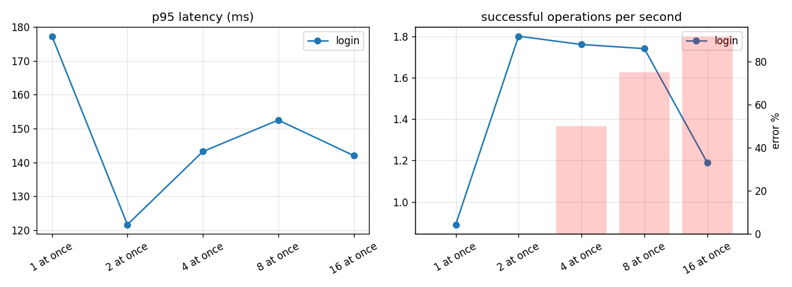
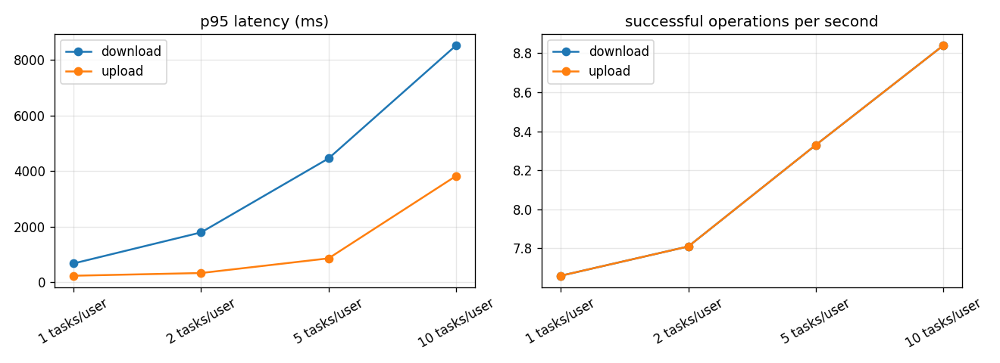
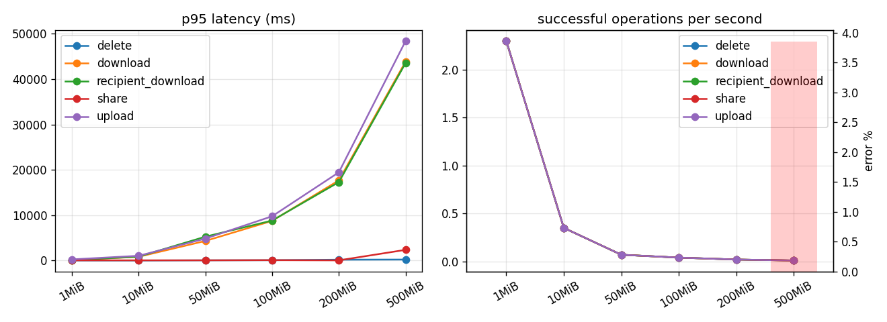
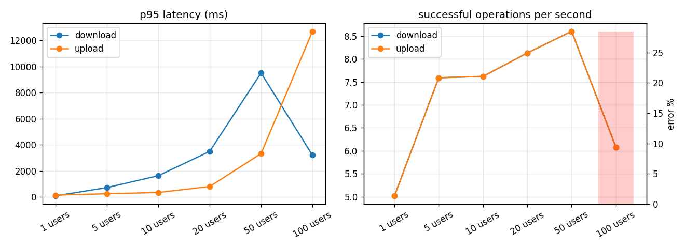
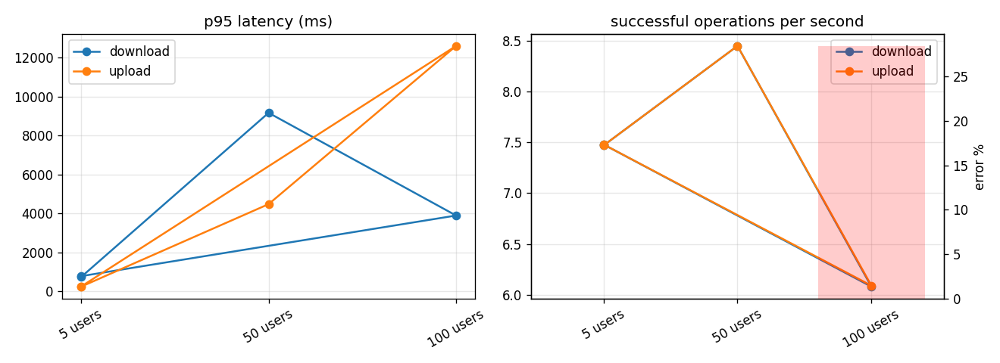

# SecureView load test report, staging, 2026-10-09

English | [简体中文](REPORT-2026-10-09.zh-CN.md)

Run 22:02 to 22:53 (+08) against `https://secureview.tech` at release `ac5e2b0`, which has the
upload pool fix (#163), the deadlock retry and its log line (#139, #202), the per-address limits
sized for one NAT (#210) and today's review fixes (#216). This is the after-fix run. The
[2026-10-03/04 report](REPORT-2026-10-03.md) is kept unchanged as the **before-fix baseline**.

The tables further down come from `secureview_load.report`, built from the `summary.json` files in
[`raw/`](raw/) and the server sampler CSV [`server-metrics-2026-10-09.csv`](server-metrics-2026-10-09.csv).
Charts are in [`charts-2026-10-09/`](charts-2026-10-09/).

## Summary

**18,256 operations. 7,444 downloads were decrypted in the client and compared with the original
SHA-256: 7,444 matched, 0 integrity failures. The server answered no 5xx at all.** The backend log
for the run holds 25,637 requests: 15,938 × 200, 9,564 × 201, 24 × 429, 1 × 413, and 2 × 422 from a
manual probe before the run. No 500.

| Question | Answer from this run |
| --- | --- |
| Concurrent users | 1, 5, 10, 20, 50 and 100 users, 60 s each, 1 MiB upload then download. Every request up to 50 users succeeded. Upload p95: 134 ms (1 user), 237 ms (5), 334 ms (10), 792 ms (20), 3.3 s (50). Download p95: 76 ms (1) up to 9.5 s (50). |
| 100 users | 407 uploads and 407 downloads succeeded with no server error. 323 uploads were answered 429 by nginx, because everything came from one address and nginx allows 50 uploads in flight per address. Real users come from different addresses, so they would not share that limit. |
| Before and after the fix | On 2026-10-03, at 100 users, 65 to 78 % of uploads failed with HTTP 500 (`QueuePool limit … reached`). Today the same step gave **0 × 500**. |
| Throughput ceiling | From 10 users up, throughput stays at about 8 to 9 MiB/s of file data each way (about 70 Mbit/s) while server CPU averages under 11 %. Upload and download run at the same time, and HTTPS, HTTP and the envelope add overhead on top of the file bytes counted here, so the VPS's 100 Mbit/s port (measured 94 Mbit/s down and 97 Mbit/s up on the same night) is close to full. The limit is the network, not the application. |
| File types and sizes | pdf, png, jpg, mp4, zip and exe, each at 1, 10, 50, 100, 200 and 500 MiB: **36/36 files uploaded, downloaded, shared, downloaded by the recipient and deleted; 72/72 downloads byte-exact.** A 500 MiB file took about 48 s to upload and 43 s to download. |
| Parallel tasks per user | 5 users with 1, 2, 5 and 10 tasks each: 0 errors. Throughput rises from 7.7 to 8.8 ops/s; latency grows because the tasks share the same link. |
| Mixed load | 5 users, 70/20/10 upload, download, share and list mix for 5 minutes: 4,347 operations, 0 errors, about 14.5 ops/s in every 30 s window, upload p95 358 ms, download p95 1.6 s. |
| Overload and recovery | 5, 50, 100, then 5 users: the last 5-user step was back to the first one (upload p95 251 ms against 244 ms), with no restart. |
| Sign-in | 1 and 2 at once all succeed. With 4, 8 and 16 at once, 50 %, 75 % and 92 % were answered 429 straight away, from the Argon2id cap of 2 checks at a time and nginx's 60 credential checks a minute per address. No 500. |
| Deadlocks | MySQL reported deadlock 1213 eight times. Each was retried once by the #139 retry and succeeded (`mysql_transaction_retry code=1213 attempt=2 of 3`), so no user saw an error. The #202 log line made this visible; the 10-03 run could not tell. |
| Server resources | CPU average 4.5 %, peak 42 %. RAM used 2.9 to 3.4 GiB of 16 GiB. API process RSS 199 MiB for the whole run. MySQL CPU peak 47 %. iowait peak 6.9 %. |

## How to read the 429s

Everything was sent from one home address through the public URL, the same path a real user takes:
HTTPS, nginx, then the API. The limits were left on. A 429 means a limit worked as designed, not
that the server failed:

| 429 source | Count | Where |
| --- | ---: | --- |
| nginx, 50 uploads in flight per address | 644 | the two 100-user steps (323 + 321) |
| nginx, API 30 requests a second per address | 1 | a download in the second 100-user step |
| Argon2id cap (2 at a time) and nginx 60 credential checks a minute | 68 | the sign-in test with 4, 8 and 16 at once |
| **Total** | **713** | |

The one 413 is the 2 GiB storage quota. The size matrix gave the pdf files to account 001, which
already held 1,692 MiB of 1 MiB files from the earlier steps, so the 500 MiB pdf would have gone past
2 GiB. The quota refused it, which is correct. The same file was then sent again from an account that
was nearly empty, and it went through byte-exact (`raw/sizes-20261009T144951Z`). The size matrix in
the tool now picks its own owner per type, but the run reused the fleet's first accounts.

## Test conditions

- **Generator:** the load tool on a MacBook on a home broadband connection, through the public URL.
  No SSH tunnel this time. A tunnel run straight to the API (as on 10-03) was considered for a
  like-for-like comparison but not done: it needs a temporary sshd change on the production host,
  and the public-path result already answers the question.
- **Limits stayed on:** nginx 30 requests a second per address (burst 60), 60 credential checks a
  minute (burst 30), 50 uploads in flight per address, and the 2 GiB per-account storage and 5 GiB
  daily upload quotas. To stay inside the quotas, the size matrix uses one owner per file type and
  deletes each file once it is verified.
- **Accounts:** 100 throwaway `loadtest-e4d76a-*` accounts made with `seed_load_users.py`. All were
  deleted through the API afterwards (`cleanup`), which also destroyed their files. The demo
  accounts were not used.
- **Server was not paused:** timers kept running. No backup or sweep fell inside the run (04:15
  and 05:30), and the CI runners were idle.
- **Network measured the same night (to Cloudflare):** the VPS port did 94 Mbit/s down and 97 Mbit/s
  up; the MacBook did 62 to 132 Mbit/s down and 475 Mbit/s up on one connection, and 821 Mbit/s down and
  493 Mbit/s up on speedtest.net with several connections, to a Kuala Lumpur server. Each 500 MiB
  file moved at 87 to 88 Mbit/s up (about 48 s) and 96 to 98 Mbit/s down (about 43 s), so even one
  transfer fills the VPS's 100 Mbit/s port. The MiB/s column in the size tables below is lower (3.4
  to 3.7) because it divides the bytes by the whole step, which also includes sharing, deleting and
  the client's own encryption between transfers.

## Compared with the before-fix baseline (2026-10-03/04)

| Measure | 2026-10-03 (before) | 2026-10-09 (after) |
| --- | --- | --- |
| Path | SSH tunnel to the API, no nginx | Public HTTPS through nginx, limits on |
| 100 users, server errors | 65 to 78 % of uploads were HTTP 500 | 0 × 500 (some 429 from the per-address upload limit) |
| 50 users, server errors | 0 | 0 |
| Integrity | 5,094 verified, 0 failures | 7,444 verified, 0 failures |
| 6 types × 6 sizes | 144/144 operations, 72/72 verified | 36/36 files, 72/72 verified |
| 500 MiB file | 146 s up, 295 s down (slower link) | about 48 s up, 43 s down |
| API memory | 158 to 159 MiB, flat | 199 MiB, flat |
| Deadlocks reaching a user | 0 (retries not logged) | 0 (8 retried once and logged) |

The two runs used different paths and links, so the latency numbers are not directly comparable.
The error columns are: the 100-user step that failed before now has no server error.

## Not repeated from the baseline

The 15, 30 and 60 minute soaks were not re-run. The 10-03 soak showed flat memory and connections
over 58 minutes, and nothing changed in that area apart from the pool fix, which the 5-minute mixed
load here covers.

## Generated tables

Everything below is produced by `secureview_load.report` from `raw/*-20261009*/summary.json` and the server CSV. Server columns are average / peak during each step.

## logins: `logins-20261009T141529Z`

Target `https://secureview.tech/api/v1`, algorithm AES-256-GCM. Request times are measured at the client and include the network; crypto times are the client's own encryption or decryption (the server never decrypts).

| Step | Op | n | ok | error % | p50 ms | p95 ms | p99 ms | ops/s | MiB/s | crypto p50 ms | errors |
|---|---|---:|---:|---:|---:|---:|---:|---:|---:|---:|---|
| 1 at once | login | 3 | 3 | 0.0 | 95 | 177 | 177 | 0.89 | 0.00 | - |  |
| 2 at once | login | 6 | 6 | 0.0 | 104 | 122 | 122 | 1.80 | 0.00 | - |  |
| 4 at once | login | 12 | 6 | 50.0 | 124 | 143 | 143 | 1.76 | 0.00 | - | http_429 x6 |
| 8 at once | login | 24 | 6 | 75.0 | 137 | 152 | 152 | 1.74 | 0.00 | - | http_429 x18 |
| 16 at once | login | 48 | 4 | 91.7 | 111 | 142 | 142 | 1.19 | 0.00 | - | http_429 x44 |

Server during each step (mean / peak):

| Step | CPU % | iowait % | RAM used MiB | API proc CPU % | API RSS MiB | MySQL CPU % | DB conns | disk write MB/s | net rx MB/s | net tx MB/s |
|---|---:|---:|---:|---:|---:|---:|---:|---:|---:|---:|
| 1 at once | 3.4 / 4.9 | 0.1 / 0.1 | 2886.5 / 2889.0 | 0.8 / 1.5 | 199.0 / 199.0 | 1.0 / 1.5 | 15.0 / 15.0 | 0.9 / 1.2 | 0.0 / 0.0 | 0.0 / 0.0 |
| 2 at once | 4.5 / 5.9 | 0.1 / 0.1 | 2966.0 / 2990.0 | 0.2 / 0.5 | 199.0 / 199.0 | 1.2 / 1.5 | 15.0 / 15.0 | 1.5 / 1.6 | 0.0 / 0.0 | 0.0 / 0.0 |
| 4 at once | 7.3 / 7.3 | 0.1 / 0.1 | 2978.0 / 2978.0 | 0.0 / 0.0 | 199.0 / 199.0 | 2.0 / 2.0 | 15.0 / 15.0 | 1.5 / 1.5 | 0.0 / 0.0 | 0.0 / 0.0 |
| 8 at once | 5.3 / 6.6 | 0.1 / 0.1 | 2986.0 / 3011.0 | 0.2 / 0.5 | 199.0 / 199.0 | 2.8 / 3.0 | 15.0 / 15.0 | 1.4 / 1.6 | 0.0 / 0.0 | 0.0 / 0.0 |
| 16 at once | 5.4 / 5.4 | 0.1 / 0.1 | 2915.0 / 2915.0 | 0.5 / 0.5 | 199.0 / 199.0 | 1.5 / 1.5 | 15.0 / 15.0 | 1.4 / 1.4 | 0.0 / 0.0 | 0.1 / 0.1 |

## mixed: `mixed-20261009T141550Z`

Target `https://secureview.tech/api/v1`, algorithm AES-256-GCM. Request times are measured at the client and include the network; crypto times are the client's own encryption or decryption (the server never decrypts).

Sign-in (Argon2id on the server): p50 106 ms, p95 642 ms over 12 sign-ins.

| Step | Op | n | ok | error % | p50 ms | p95 ms | p99 ms | ops/s | MiB/s | crypto p50 ms | errors |
|---|---|---:|---:|---:|---:|---:|---:|---:|---:|---:|---|
| mixed 5 users | download | 878 | 878 | 0.0 | 718 | 1596 | 2044 | 2.93 | 2.93 | 5 |  |
| mixed 5 users | list | 217 | 217 | 0.0 | 140 | 240 | 296 | 0.72 | 0.00 | - |  |
| mixed 5 users | share | 223 | 223 | 0.0 | 234 | 766 | 944 | 0.74 | 0.00 | - |  |
| mixed 5 users | upload | 3029 | 3029 | 0.0 | 200 | 358 | 625 | 10.09 | 10.09 | 1 |  |

Server during each step (mean / peak):

| Step | CPU % | iowait % | RAM used MiB | API proc CPU % | API RSS MiB | MySQL CPU % | DB conns | disk write MB/s | net rx MB/s | net tx MB/s |
|---|---:|---:|---:|---:|---:|---:|---:|---:|---:|---:|
| mixed 5 users | 7.8 / 10.7 | 0.6 / 1.2 | 2905.3 / 3021.0 | 0.3 / 7.4 | 199.0 / 199.0 | 14.5 / 23.3 | 15.0 / 15.0 | 16.5 / 22.7 | 10.8 / 12.1 | 3.4 / 7.5 |

Time series for mixed 5 users (per window):

| t (s) | ops | errors | p95 ms | ops/s |
|---:|---:|---:|---:|---:|
| 0.0 | 449 | 0 | 926 | 14.97 |
| 30.0 | 438 | 0 | 1038 | 14.6 |
| 60.0 | 441 | 0 | 1005 | 14.7 |
| 90.0 | 434 | 0 | 1193 | 14.47 |
| 120.0 | 422 | 0 | 984 | 14.07 |
| 150.0 | 435 | 0 | 1124 | 14.5 |
| 180.0 | 424 | 0 | 1043 | 14.13 |
| 210.0 | 422 | 0 | 1091 | 14.07 |
| 240.0 | 434 | 0 | 1089 | 14.47 |
| 270.0 | 448 | 0 | 979 | 14.93 |

## parallel: `parallel-20261009T141043Z`

Target `https://secureview.tech/api/v1`, algorithm AES-256-GCM. Request times are measured at the client and include the network; crypto times are the client's own encryption or decryption (the server never decrypts).

Sign-in (Argon2id on the server): p50 123 ms, p95 661 ms over 5 sign-ins.

| Step | Op | n | ok | error % | p50 ms | p95 ms | p99 ms | ops/s | MiB/s | crypto p50 ms | errors |
|---|---|---:|---:|---:|---:|---:|---:|---:|---:|---:|---|
| 1 tasks/user | download | 463 | 463 | 0.0 | 485 | 674 | 836 | 7.66 | 7.66 | 5 |  |
| 1 tasks/user | upload | 463 | 463 | 0.0 | 140 | 233 | 419 | 7.66 | 7.66 | 1 |  |
| 2 tasks/user | download | 474 | 474 | 0.0 | 1049 | 1792 | 2315 | 7.81 | 7.81 | 4 |  |
| 2 tasks/user | upload | 474 | 474 | 0.0 | 152 | 330 | 1077 | 7.81 | 7.81 | 1 |  |
| 5 tasks/user | download | 511 | 511 | 0.0 | 2529 | 4454 | 5208 | 8.33 | 8.33 | 4 |  |
| 5 tasks/user | upload | 511 | 511 | 0.0 | 186 | 859 | 2512 | 8.33 | 8.33 | 1 |  |
| 10 tasks/user | download | 549 | 549 | 0.0 | 4540 | 8522 | 10658 | 8.84 | 8.84 | 4 |  |
| 10 tasks/user | upload | 549 | 549 | 0.0 | 249 | 3824 | 6583 | 8.84 | 8.84 | 1 |  |

Server during each step (mean / peak):

| Step | CPU % | iowait % | RAM used MiB | API proc CPU % | API RSS MiB | MySQL CPU % | DB conns | disk write MB/s | net rx MB/s | net tx MB/s |
|---|---:|---:|---:|---:|---:|---:|---:|---:|---:|---:|
| 1 tasks/user | 7.7 / 9.7 | 0.5 / 0.7 | 2829.4 / 2920.0 | 0.3 / 1.5 | 199.0 / 199.0 | 13.1 / 17.4 | 15.0 / 15.0 | 12.5 / 18.2 | 8.0 / 9.2 | 8.3 / 9.6 |
| 2 tasks/user | 8.4 / 11.4 | 0.6 / 0.8 | 2844.0 / 2963.0 | 0.2 / 1.5 | 199.0 / 199.0 | 17.2 / 21.9 | 15.0 / 15.0 | 13.0 / 18.3 | 8.2 / 10.9 | 8.8 / 11.3 |
| 5 tasks/user | 9.3 / 16.8 | 0.6 / 1.1 | 2851.3 / 2886.0 | 0.2 / 2.0 | 199.0 / 199.0 | 20.1 / 35.8 | 15.0 / 15.0 | 14.5 / 21.6 | 9.3 / 10.8 | 9.9 / 14.3 |
| 10 tasks/user | 10.6 / 22.9 | 0.6 / 1.2 | 2885.0 / 2962.0 | 0.3 / 2.0 | 199.0 / 199.0 | 22.2 / 47.2 | 16.7 / 45.0 | 15.8 / 41.0 | 9.7 / 12.4 | 10.8 / 15.8 |

## sizes: `sizes-20261009T142643Z`

Target `https://secureview.tech/api/v1`, algorithm AES-256-GCM. Request times are measured at the client and include the network; crypto times are the client's own encryption or decryption (the server never decrypts).

Sign-in (Argon2id on the server): p50 130 ms, p95 902 ms over 7 sign-ins.

| Step | Op | n | ok | error % | p50 ms | p95 ms | p99 ms | ops/s | MiB/s | crypto p50 ms | errors |
|---|---|---:|---:|---:|---:|---:|---:|---:|---:|---:|---|
| 1MiB | delete | 6 | 6 | 0.0 | 21 | 34 | 34 | 2.30 | 0.00 | - |  |
| 1MiB | download | 6 | 6 | 0.0 | 94 | 104 | 104 | 2.30 | 2.30 | 5 |  |
| 1MiB | recipient_download | 6 | 6 | 0.0 | 78 | 96 | 96 | 2.30 | 2.30 | 4 |  |
| 1MiB | share | 6 | 6 | 0.0 | 54 | 58 | 58 | 2.30 | 0.00 | - |  |
| 1MiB | upload | 6 | 6 | 0.0 | 135 | 266 | 266 | 2.30 | 2.30 | 1 |  |
| 10MiB | delete | 6 | 6 | 0.0 | 25 | 27 | 27 | 0.35 | 0.00 | - |  |
| 10MiB | download | 6 | 6 | 0.0 | 835 | 844 | 844 | 0.35 | 3.50 | 10 |  |
| 10MiB | recipient_download | 6 | 6 | 0.0 | 860 | 882 | 882 | 0.35 | 3.50 | 6 |  |
| 10MiB | share | 6 | 6 | 0.0 | 49 | 62 | 62 | 0.35 | 0.00 | - |  |
| 10MiB | upload | 6 | 6 | 0.0 | 999 | 1062 | 1062 | 0.35 | 3.50 | 2 |  |
| 50MiB | delete | 6 | 6 | 0.0 | 32 | 67 | 67 | 0.07 | 0.00 | - |  |
| 50MiB | download | 6 | 6 | 0.0 | 4278 | 4338 | 4338 | 0.07 | 3.57 | 47 |  |
| 50MiB | recipient_download | 6 | 6 | 0.0 | 4321 | 5280 | 5280 | 0.07 | 3.57 | 51 |  |
| 50MiB | share | 6 | 6 | 0.0 | 49 | 66 | 66 | 0.07 | 0.00 | - |  |
| 50MiB | upload | 6 | 6 | 0.0 | 4766 | 4853 | 4853 | 0.07 | 3.57 | 8 |  |
| 100MiB | delete | 6 | 6 | 0.0 | 66 | 88 | 88 | 0.04 | 0.00 | - |  |
| 100MiB | download | 6 | 6 | 0.0 | 8602 | 8759 | 8759 | 0.04 | 3.62 | 99 |  |
| 100MiB | recipient_download | 6 | 6 | 0.0 | 8633 | 8830 | 8830 | 0.04 | 3.62 | 62 |  |
| 100MiB | share | 6 | 6 | 0.0 | 53 | 101 | 101 | 0.04 | 0.00 | - |  |
| 100MiB | upload | 6 | 6 | 0.0 | 9558 | 9776 | 9776 | 0.04 | 3.62 | 15 |  |
| 200MiB | delete | 6 | 6 | 0.0 | 82 | 203 | 203 | 0.02 | 0.00 | - |  |
| 200MiB | download | 6 | 6 | 0.0 | 17206 | 17686 | 17686 | 0.02 | 3.63 | 150 |  |
| 200MiB | recipient_download | 6 | 6 | 0.0 | 17182 | 17296 | 17296 | 0.02 | 3.63 | 154 |  |
| 200MiB | share | 6 | 6 | 0.0 | 51 | 57 | 57 | 0.02 | 0.00 | - |  |
| 200MiB | upload | 6 | 6 | 0.0 | 19109 | 19462 | 19462 | 0.02 | 3.63 | 33 |  |
| 500MiB | delete | 5 | 5 | 0.0 | 160 | 234 | 234 | 0.01 | 0.00 | - |  |
| 500MiB | download | 5 | 5 | 0.0 | 43037 | 43865 | 43865 | 0.01 | 3.36 | 491 |  |
| 500MiB | recipient_download | 5 | 5 | 0.0 | 43170 | 43543 | 43543 | 0.01 | 3.36 | 654 |  |
| 500MiB | share | 5 | 5 | 0.0 | 61 | 2372 | 2372 | 0.01 | 0.00 | - |  |
| 500MiB | upload | 6 | 5 | 16.7 | 48189 | 48401 | 48401 | 0.01 | 3.36 | 121 | http_413 x1 |

Server during each step (mean / peak):

| Step | CPU % | iowait % | RAM used MiB | API proc CPU % | API RSS MiB | MySQL CPU % | DB conns | disk write MB/s | net rx MB/s | net tx MB/s |
|---|---:|---:|---:|---:|---:|---:|---:|---:|---:|---:|
| 1MiB | 8.5 / 11.9 | 0.2 / 0.3 | 3079.5 / 3090.0 | 0.0 / 0.0 | 199.0 / 199.0 | 8.7 / 13.9 | 15.0 / 15.0 | 3.0 / 4.7 | 1.4 / 2.2 | 2.7 / 5.0 |
| 10MiB | 2.4 / 3.1 | 0.1 / 0.1 | 3016.4 / 3058.0 | 0.2 / 0.5 | 199.0 / 199.0 | 2.9 / 4.5 | 15.0 / 15.0 | 6.2 / 7.8 | 4.1 / 5.8 | 7.4 / 10.8 |
| 50MiB | 2.0 / 6.2 | 0.1 / 0.3 | 3019.5 / 3100.0 | 0.2 / 1.5 | 199.0 / 199.0 | 1.1 / 3.0 | 15.0 / 15.0 | 6.0 / 43.9 | 3.9 / 12.3 | 8.0 / 13.2 |
| 100MiB | 2.1 / 7.4 | 0.1 / 0.6 | 3147.2 / 3265.0 | 0.3 / 2.0 | 199.0 / 199.0 | 0.8 / 3.0 | 15.0 / 15.0 | 7.3 / 63.7 | 4.0 / 12.3 | 7.8 / 13.4 |
| 200MiB | 2.0 / 10.5 | 0.1 / 3.4 | 3016.2 / 3209.0 | 0.3 / 3.0 | 199.0 / 199.0 | 0.6 / 2.5 | 15.0 / 15.0 | 7.8 / 163.7 | 3.9 / 12.3 | 7.9 / 13.1 |
| 500MiB | 2.1 / 13.8 | 0.1 / 6.9 | 2970.0 / 3212.0 | 0.3 / 2.0 | 199.0 / 199.0 | 0.5 / 2.5 | 15.0 / 15.0 | 14.5 / 310.8 | 4.4 / 12.4 | 7.3 / 14.3 |

## sizes: `sizes-20261009T144951Z`

Target `https://secureview.tech/api/v1`, algorithm AES-256-GCM. Request times are measured at the client and include the network; crypto times are the client's own encryption or decryption (the server never decrypts).

Sign-in (Argon2id on the server): p50 124 ms, p95 268 ms over 2 sign-ins.

| Step | Op | n | ok | error % | p50 ms | p95 ms | p99 ms | ops/s | MiB/s | crypto p50 ms | errors |
|---|---|---:|---:|---:|---:|---:|---:|---:|---:|---:|---|
| 500MiB | delete | 1 | 1 | 0.0 | 255 | 255 | 255 | 0.01 | 0.00 | - |  |
| 500MiB | download | 1 | 1 | 0.0 | 42939 | 42939 | 42939 | 0.01 | 3.68 | 172 |  |
| 500MiB | recipient_download | 1 | 1 | 0.0 | 42787 | 42787 | 42787 | 0.01 | 3.68 | 277 |  |
| 500MiB | share | 1 | 1 | 0.0 | 47 | 47 | 47 | 0.01 | 0.00 | - |  |
| 500MiB | upload | 1 | 1 | 0.0 | 47445 | 47445 | 47445 | 0.01 | 3.68 | 113 |  |

Server during each step (mean / peak):

| Step | CPU % | iowait % | RAM used MiB | API proc CPU % | API RSS MiB | MySQL CPU % | DB conns | disk write MB/s | net rx MB/s | net tx MB/s |
|---|---:|---:|---:|---:|---:|---:|---:|---:|---:|---:|
| 500MiB | 2.0 / 13.4 | 0.2 / 3.9 | 3021.7 / 3163.0 | 0.2 / 2.0 | 199.0 / 199.0 | 0.5 / 1.5 | 15.0 / 15.0 | 15.5 / 329.4 | 4.0 / 12.3 | 7.9 / 12.9 |

## smoke: `smoke-20261009T140252Z`

Target `https://secureview.tech/api/v1`, algorithm AES-256-GCM. Request times are measured at the client and include the network; crypto times are the client's own encryption or decryption (the server never decrypts).

Sign-in (Argon2id on the server): p50 290 ms, p95 363 ms over 2 sign-ins.

| Step | Op | n | ok | error % | p50 ms | p95 ms | p99 ms | ops/s | MiB/s | crypto p50 ms | errors |
|---|---|---:|---:|---:|---:|---:|---:|---:|---:|---:|---|
| 1MiB | delete | 1 | 1 | 0.0 | 28 | 28 | 28 | 1.09 | 0.00 | - |  |
| 1MiB | download | 1 | 1 | 0.0 | 96 | 96 | 96 | 1.09 | 1.09 | 8 |  |
| 1MiB | recipient_download | 1 | 1 | 0.0 | 89 | 89 | 89 | 1.09 | 1.09 | 14 |  |
| 1MiB | share | 1 | 1 | 0.0 | 431 | 431 | 431 | 1.09 | 0.00 | - |  |
| 1MiB | upload | 1 | 1 | 0.0 | 238 | 238 | 238 | 1.09 | 1.09 | 6 |  |

Server during each step (mean / peak):

| Step | CPU % | iowait % | RAM used MiB | API proc CPU % | API RSS MiB | MySQL CPU % | DB conns | disk write MB/s | net rx MB/s | net tx MB/s |
|---|---:|---:|---:|---:|---:|---:|---:|---:|---:|---:|
| 1MiB | 6.6 / 6.6 | 0.2 / 0.2 | 2850.0 / 2850.0 | 0.0 / 0.0 | 199.0 / 199.0 | 2.5 / 2.5 | 6.0 / 6.0 | 0.9 / 0.9 | 0.5 / 0.5 | 0.5 / 0.5 |

## steps: `steps-20261009T140254Z`

Target `https://secureview.tech/api/v1`, algorithm AES-256-GCM. Request times are measured at the client and include the network; crypto times are the client's own encryption or decryption (the server never decrypts).

Sign-in (Argon2id on the server): p50 124 ms, p95 1030 ms over 184 sign-ins.

| Step | Op | n | ok | error % | p50 ms | p95 ms | p99 ms | ops/s | MiB/s | crypto p50 ms | errors |
|---|---|---:|---:|---:|---:|---:|---:|---:|---:|---:|---|
| 1 users | download | 302 | 302 | 0.0 | 63 | 76 | 92 | 5.02 | 5.02 | 5 |  |
| 1 users | upload | 302 | 302 | 0.0 | 127 | 134 | 139 | 5.02 | 5.02 | 1 |  |
| 5 users | download | 458 | 458 | 0.0 | 485 | 710 | 989 | 7.59 | 7.59 | 5 |  |
| 5 users | upload | 458 | 458 | 0.0 | 136 | 237 | 378 | 7.59 | 7.59 | 1 |  |
| 10 users | download | 461 | 461 | 0.0 | 1093 | 1621 | 1967 | 7.62 | 7.62 | 8 |  |
| 10 users | upload | 461 | 461 | 0.0 | 149 | 334 | 883 | 7.62 | 7.62 | 1 |  |
| 20 users | download | 495 | 495 | 0.0 | 2075 | 3490 | 3972 | 8.13 | 8.13 | 8 |  |
| 20 users | upload | 495 | 495 | 0.0 | 206 | 792 | 1965 | 8.13 | 8.13 | 1 |  |
| 50 users | download | 537 | 537 | 0.0 | 4694 | 9506 | 11315 | 8.60 | 8.60 | 7 |  |
| 50 users | upload | 537 | 537 | 0.0 | 256 | 3318 | 5753 | 8.60 | 8.60 | 1 |  |
| 100 users | download | 407 | 407 | 0.0 | 1339 | 3205 | 6957 | 6.08 | 6.08 | 5 |  |
| 100 users | upload | 730 | 407 | 44.2 | 7833 | 12702 | 15402 | 6.08 | 6.08 | 1 | http_429 x323 |

Server during each step (mean / peak):

| Step | CPU % | iowait % | RAM used MiB | API proc CPU % | API RSS MiB | MySQL CPU % | DB conns | disk write MB/s | net rx MB/s | net tx MB/s |
|---|---:|---:|---:|---:|---:|---:|---:|---:|---:|---:|
| 1 users | 4.8 / 6.3 | 0.4 / 0.5 | 2798.0 / 2825.0 | 0.2 / 1.5 | 199.0 / 199.0 | 6.4 / 7.5 | 6.0 / 6.0 | 8.3 / 14.1 | 5.4 / 5.8 | 5.3 / 5.9 |
| 5 users | 7.0 / 8.9 | 0.5 / 0.7 | 2802.7 / 2819.0 | 0.2 / 1.5 | 199.0 / 199.0 | 9.1 / 10.9 | 15.0 / 15.0 | 12.5 / 18.6 | 8.0 / 9.4 | 8.3 / 9.8 |
| 10 users | 7.6 / 10.8 | 0.6 / 0.8 | 2822.0 / 2869.0 | 0.2 / 1.5 | 199.0 / 199.0 | 9.6 / 10.9 | 15.0 / 15.0 | 12.9 / 18.5 | 8.3 / 9.1 | 8.8 / 10.4 |
| 20 users | 8.7 / 15.5 | 0.6 / 0.9 | 2867.2 / 2991.0 | 0.3 / 3.0 | 199.0 / 199.0 | 10.7 / 13.9 | 15.4 / 27.0 | 13.5 / 20.9 | 8.6 / 11.5 | 9.4 / 14.2 |
| 50 users | 10.1 / 41.8 | 0.6 / 1.0 | 2961.6 / 3079.0 | 0.2 / 1.5 | 199.0 / 199.0 | 11.1 / 15.9 | 15.0 / 15.0 | 15.2 / 27.9 | 9.5 / 12.3 | 10.3 / 15.6 |
| 100 users | 7.4 / 11.6 | 0.4 / 1.0 | 2965.1 / 3155.0 | 0.3 / 2.0 | 199.0 / 199.0 | 7.8 / 16.4 | 15.0 / 15.0 | 12.3 / 23.7 | 12.1 / 12.4 | 6.9 / 15.9 |

## steps: `steps-20261009T142054Z`

Target `https://secureview.tech/api/v1`, algorithm AES-256-GCM. Request times are measured at the client and include the network; crypto times are the client's own encryption or decryption (the server never decrypts).

Sign-in (Argon2id on the server): p50 121 ms, p95 486 ms over 241 sign-ins.

| Step | Op | n | ok | error % | p50 ms | p95 ms | p99 ms | ops/s | MiB/s | crypto p50 ms | errors |
|---|---|---:|---:|---:|---:|---:|---:|---:|---:|---:|---|
| 5 users | download | 450 | 450 | 0.0 | 487 | 738 | 906 | 7.47 | 7.47 | 8 |  |
| 5 users | upload | 450 | 450 | 0.0 | 140 | 244 | 405 | 7.47 | 7.47 | 1 |  |
| 50 users | download | 528 | 528 | 0.0 | 4761 | 9163 | 10677 | 8.45 | 8.45 | 8 |  |
| 50 users | upload | 528 | 528 | 0.0 | 238 | 4478 | 5510 | 8.45 | 8.45 | 1 |  |
| 100 users | download | 407 | 406 | 0.2 | 1288 | 3894 | 7208 | 6.08 | 6.08 | 7 | http_429 x1 |
| 100 users | upload | 728 | 407 | 44.1 | 7839 | 12596 | 15769 | 6.09 | 6.09 | 1 | http_429 x321 |
| 5 users | download | 451 | 451 | 0.0 | 487 | 784 | 912 | 7.48 | 7.48 | 5 |  |
| 5 users | upload | 451 | 451 | 0.0 | 136 | 251 | 500 | 7.48 | 7.48 | 1 |  |

Server during each step (mean / peak):

| Step | CPU % | iowait % | RAM used MiB | API proc CPU % | API RSS MiB | MySQL CPU % | DB conns | disk write MB/s | net rx MB/s | net tx MB/s |
|---|---:|---:|---:|---:|---:|---:|---:|---:|---:|---:|
| 5 users | 8.0 / 13.2 | 0.5 / 0.7 | 2945.0 / 3077.0 | 0.2 / 2.0 | 199.0 / 199.0 | 14.8 / 16.4 | 15.0 / 15.0 | 13.1 / 19.8 | 8.1 / 9.0 | 8.2 / 9.2 |
| 50 users | 9.1 / 25.5 | 0.6 / 1.3 | 2979.3 / 3012.0 | 0.2 / 1.5 | 199.0 / 199.0 | 13.0 / 35.2 | 16.5 / 42.0 | 15.6 / 31.2 | 9.4 / 12.3 | 10.2 / 15.4 |
| 100 users | 7.6 / 14.3 | 0.4 / 0.9 | 2929.1 / 2984.0 | 0.2 / 2.0 | 199.0 / 199.0 | 9.0 / 19.4 | 15.2 / 21.0 | 12.0 / 25.7 | 11.7 / 12.4 | 6.8 / 14.4 |
| 5 users | 7.8 / 9.7 | 0.5 / 0.9 | 2922.4 / 3033.0 | 0.2 / 1.5 | 199.0 / 199.0 | 15.6 / 18.9 | 15.0 / 15.0 | 12.9 / 18.1 | 8.1 / 9.1 | 8.4 / 9.5 |

