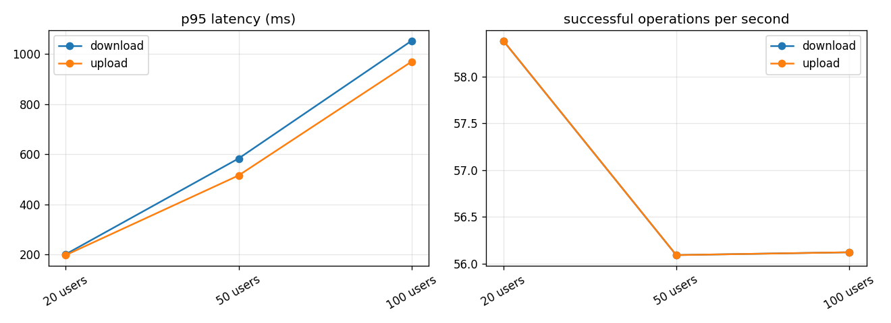

# SecureView load test report

## steps — `steps-20261003T234433Z`

Target `http://127.0.0.1:8000/api/v1`, algorithm AES-256-GCM. Request times are measured at the client and include the network; crypto times are the client's own encryption or decryption (the server never decrypts).

Sign-in (Argon2id on the server): p50 55 ms, p95 2187 ms over 100 sign-ins.

| Step | Op | n | ok | error % | p50 ms | p95 ms | p99 ms | ops/s | MiB/s | crypto p50 ms | errors |
|---|---|---:|---:|---:|---:|---:|---:|---:|---:|---:|---|
| 20 users | download | 1762 | 1762 | 0.0 | 170 | 201 | 215 | 58.38 | 58.38 | 2 |  |
| 20 users | upload | 1762 | 1762 | 0.0 | 164 | 198 | 215 | 58.38 | 58.38 | 0 |  |
| 50 users | download | 1713 | 1713 | 0.0 | 469 | 583 | 672 | 56.09 | 56.09 | 3 |  |
| 50 users | upload | 1713 | 1713 | 0.0 | 408 | 515 | 579 | 56.09 | 56.09 | 0 |  |
| 100 users | download | 1742 | 1742 | 0.0 | 921 | 1052 | 1128 | 56.12 | 56.12 | 3 |  |
| 100 users | upload | 1742 | 1742 | 0.0 | 842 | 969 | 1023 | 56.12 | 56.12 | 0 |  |

