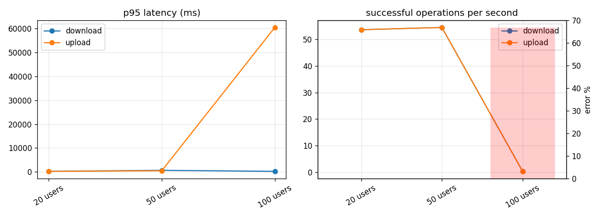

# SecureView load test report

## steps — `steps-20261003T231220Z`

Target `http://127.0.0.1:8000/api/v1`, algorithm AES-256-GCM. Request times are measured at the client and include the network; crypto times are the client's own encryption or decryption (the server never decrypts).

Sign-in (Argon2id on the server): p50 56 ms, p95 2128 ms over 100 sign-ins.

| Step | Op | n | ok | error % | p50 ms | p95 ms | p99 ms | ops/s | MiB/s | crypto p50 ms | errors |
|---|---|---:|---:|---:|---:|---:|---:|---:|---:|---:|---|
| 20 users | download | 1620 | 1620 | 0.0 | 190 | 246 | 324 | 53.63 | 53.63 | 2 |  |
| 20 users | upload | 1620 | 1620 | 0.0 | 170 | 224 | 277 | 53.63 | 53.63 | 0 |  |
| 50 users | download | 1668 | 1668 | 0.0 | 523 | 654 | 760 | 54.48 | 54.48 | 2 |  |
| 50 users | upload | 1668 | 1668 | 0.0 | 379 | 470 | 552 | 54.48 | 54.48 | 0 |  |
| 100 users | download | 20 | 20 | 0.0 | 193 | 227 | 246 | 0.33 | 0.33 | 5 |  |
| 100 users | upload | 100 | 20 | 80.0 | 60404 | 60490 | 60504 | 0.33 | 0.33 | 21 | http_500 x80 |

