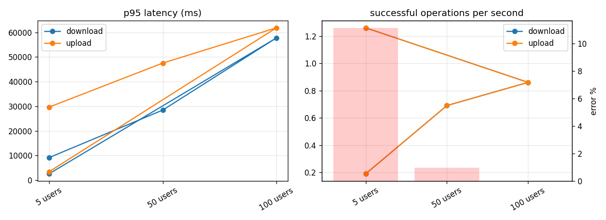

# SecureView load test report

## steps — `steps-20261004T153401Z`

Target `http://127.0.0.1:18000/api/v1`, algorithm AES-256-GCM. Request times are measured at the client and include the network; crypto times are the client's own encryption or decryption (the server never decrypts).

Sign-in (Argon2id on the server): p50 116 ms, p95 512 ms over 100 sign-ins.

| Step | Op | n | ok | error % | p50 ms | p95 ms | p99 ms | ops/s | MiB/s | crypto p50 ms | errors |
|---|---|---:|---:|---:|---:|---:|---:|---:|---:|---:|---|
| 5 users | download | 16 | 16 | 0.0 | 6953 | 9152 | 9152 | 0.19 | 0.19 | 14 |  |
| 5 users | upload | 20 | 16 | 20.0 | 17137 | 29660 | 29660 | 0.19 | 0.19 | 2 | RemoteProtocolError x4 |
| 50 users | download | 52 | 52 | 0.0 | 27987 | 28453 | 28697 | 0.69 | 0.69 | 9 |  |
| 50 users | upload | 53 | 52 | 1.9 | 47035 | 47538 | 47795 | 0.69 | 0.69 | 22 | RemoteProtocolError x1 |
| 100 users | download | 102 | 102 | 0.0 | 57096 | 57742 | 57950 | 0.86 | 0.86 | 11 |  |
| 100 users | upload | 102 | 102 | 0.0 | 61101 | 61844 | 62072 | 0.86 | 0.86 | 46 |  |
| 5 users | download | 79 | 79 | 0.0 | 1332 | 2597 | 3001 | 1.26 | 1.26 | 8 |  |
| 5 users | upload | 79 | 79 | 0.0 | 2526 | 3435 | 4024 | 1.26 | 1.26 | 1 |  |

Server during each step (mean / peak):

| Step | CPU % | iowait % | RAM used MiB | API proc CPU % | API RSS MiB | MySQL CPU % | DB conns | disk write MB/s | net rx MB/s | net tx MB/s |
|---|---:|---:|---:|---:|---:|---:|---:|---:|---:|---:|
| 5 users | 1.7 / 8.4 | 0.0 / 0.1 | 3542.7 / 3569.0 | 2.5 / 57.1 | 185.4 / 190.0 | 0.7 / 2.5 | 12.0 / 12.0 | 0.6 / 3.1 | 0.2 / 0.7 | 0.2 / 0.9 |
| 50 users | 2.7 / 14.4 | 0.1 / 1.1 | 3654.7 / 3809.0 | 7.0 / 97.9 | 231.8 / 274.0 | 1.2 / 16.4 | 13.9 / 45.0 | 1.5 / 30.6 | 0.8 / 2.1 | 0.7 / 2.1 |
| 100 users | 3.1 / 20.4 | 0.1 / 4.0 | 3732.3 / 4028.0 | 7.0 / 111.8 | 290.1 / 359.0 | 1.3 / 22.4 | 16.0 / 45.0 | 1.7 / 54.8 | 1.0 / 2.3 | 1.0 / 2.2 |
| 5 users | 3.0 / 4.9 | 0.1 / 0.9 | 3722.6 / 3755.0 | 5.8 / 11.4 | 261.9 / 287.0 | 1.9 / 3.5 | 15.0 / 15.0 | 2.4 / 10.4 | 1.5 / 2.0 | 1.4 / 2.2 |

